# Getting Started – Create Your Project

Welcome to **DA164 – Build AI Agents and Applications Natively on SAP HANA Cloud**.

In this exercise you will create a fresh CAP project and verify it starts. You will add credentials and external service models in the exercises where they are first needed — nothing else is required right now.

> **The story so far:**
> Maya is a Sales Engineer at Precision Parts AG. Every day she gets dozens of customer questions like *"do you have a corrosion-resistant fastener for marine use?"* — and it takes her 2–3 days to answer each one because S/4HANA's search only works with exact product codes. By the end of this session you will have built the app that gives her an AI-powered answer in seconds. This exercise creates the project foundation.

---

## Before you begin

Open **SAP Build Code** and log in before starting. Your login details are on your seat card — replace `XXX` with your assigned 3-digit seat number.

| | Value |
|---|---|
| **SAP Build Code URL** | [https://da164.eu10.build.cloud.sap/lobby](https://da164.eu10.build.cloud.sap/lobby) |
| **Username** | `da164-XXX@education.cloud.sap` |
| **Password** | `Acce$$teched26` |

> Your seat number is the 3-digit number at the end of your username (e.g. `da164-007` → seat **007**).

> Everything else (API key, AI Core credentials, S/4HANA model file) will be introduced at the exercise where it is first used.

---

## Step 1 – Set Up Your Dev Space

Before creating a project you need a BAS dev space with the SAP HANA extension enabled. This gives you the HANA tools, `@sap/cds-hana`, and the Database Explorer integration pre-installed.

1. From the SAP Build Code lobby, open the **Dev Space Manager**.

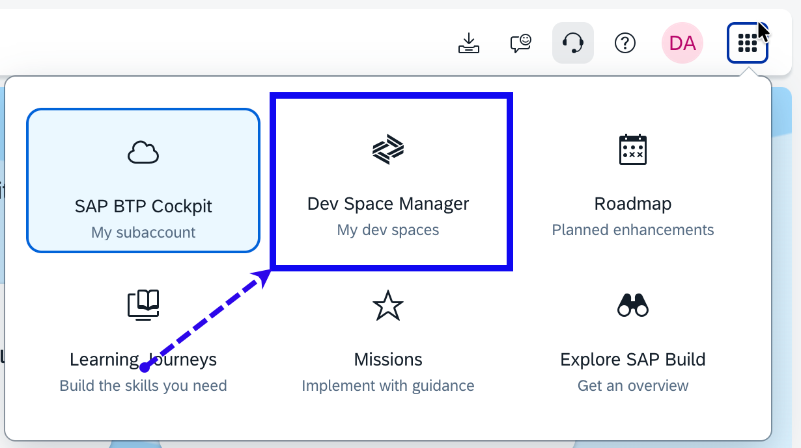

**If you have no dev space yet** (fresh account — this is the common case):

2. Click **Create Dev Space**.


3. Give it a name (e.g. `DA164`), select **Full Stack Cloud Application** as the kind, check **SAP HANA Tools** under Additional SAP Extensions, then click **Create Dev Space**.


4. Wait for the status to change to **RUNNING**, then click on it to open BAS.

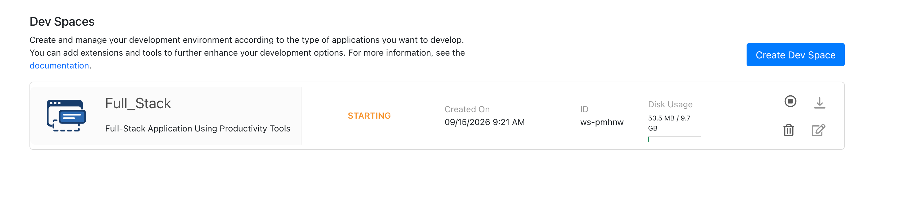

---

**If you already have a dev space** (it may be missing the HANA extension):

2. If your dev space is running, stop it first — you can only edit a dev space when it is stopped.

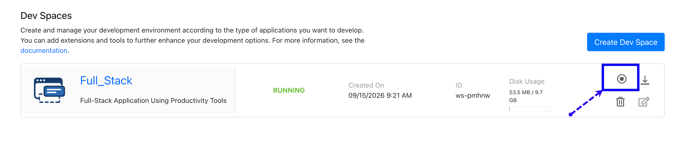

3. Click **Edit** on your dev space.

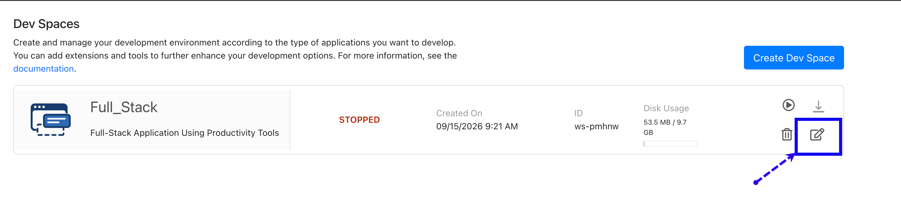

4. In the **Additional SAP Extensions** section, check **SAP HANA Tools**, then save.

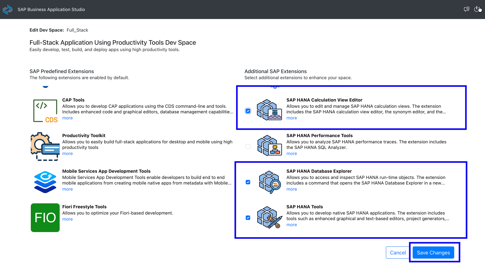

5. Start the dev space. Wait for the status to change to **RUNNING**, then click on it to open BAS.


---

## Step 2 – Create Your Project in SAP Build Code

SAP Build Code is a cloud-based development environment built on SAP Business Application Studio. It has a project wizard that sets up the full CAP project structure for you automatically.

1. SAP Build Code should still be open from when you first logged in — switch back to that tab. If your session has expired, log in again using the credentials in the table above.

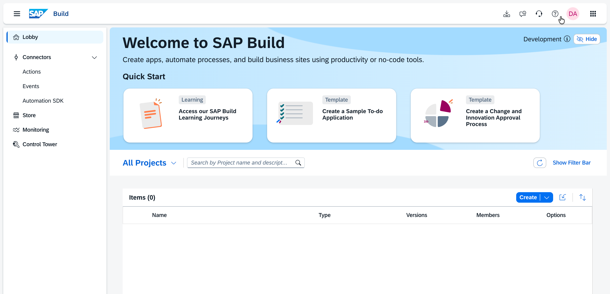

2. Click the **Create** button in the top area of the lobby.

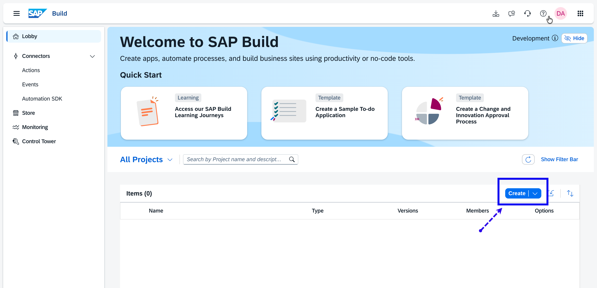

3. A dialog opens asking what you want to create. Select **Application**.

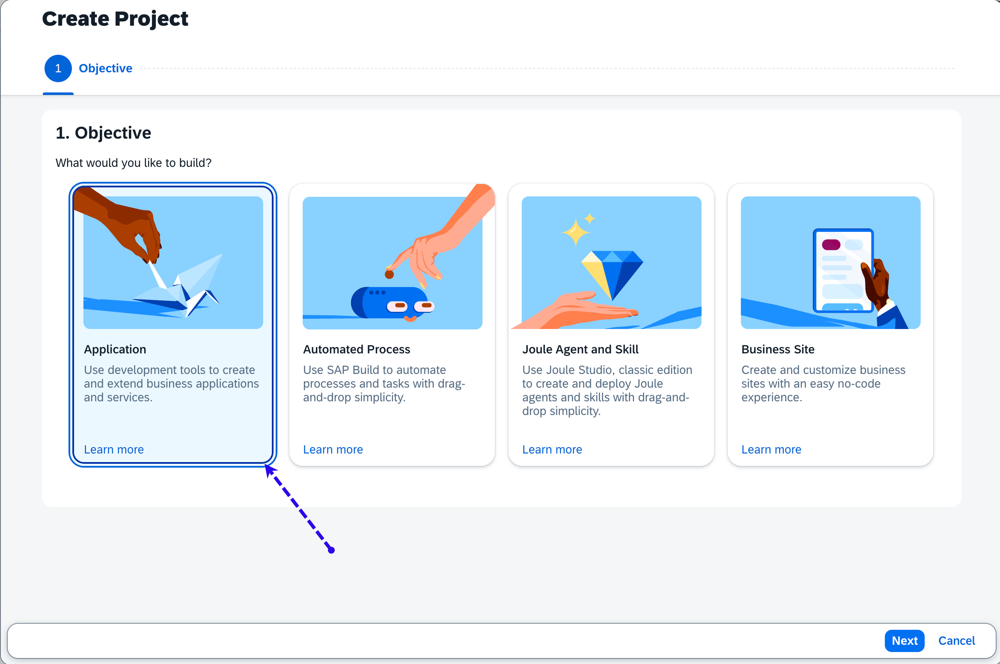

4. On the next screen, choose **Full Stack Cloud Application** as the template.

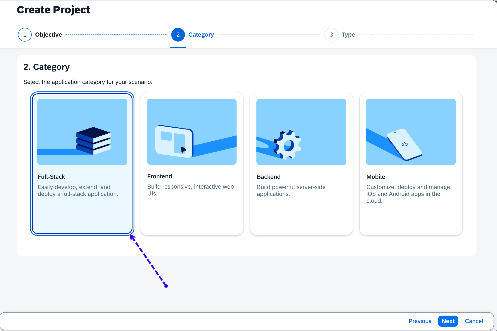

5. Choose **Node.js** as the runtime.

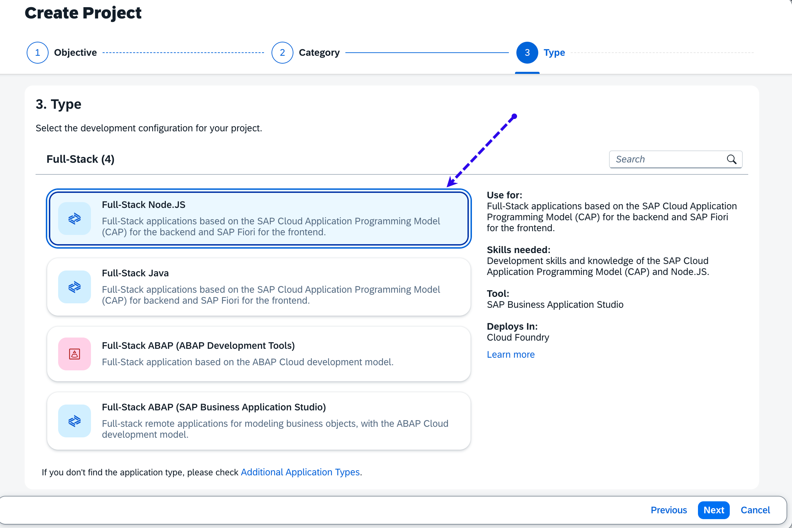

6. Enter your project name using your 3-digit seat number:

   - **Project Name**: `da164-product-advisor-001` *(replace `001` with your seat number)*

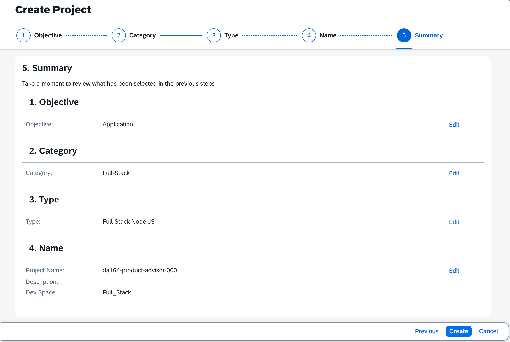

7. The wizard shows a **Review** screen summarising your choices. Confirm the details and click **Create**.

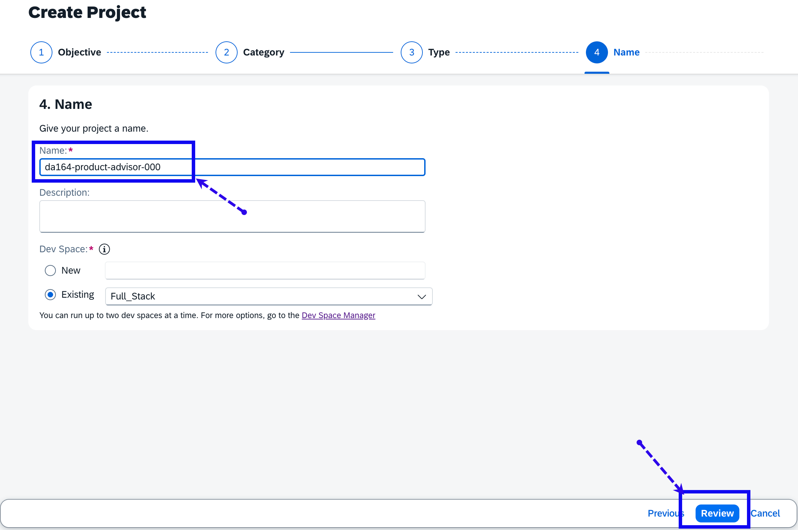

> If the wizard offered optional features such as **SAP HANA Cloud** or **MTA deployment**, leave them unselected. You will add these via `cds add hana` and `cds add mta` from the terminal at the point in the exercises where they are needed.

8. SAP Build Code creates the project. When it finishes, click on your project to open it in BAS.

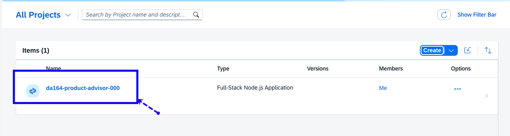

9. BAS opens. If it lands on a **Project Overview** or **Storyboard** page, click the **Explorer** icon (the overlapping-pages icon at the top of the left sidebar) to switch to the familiar file tree view.


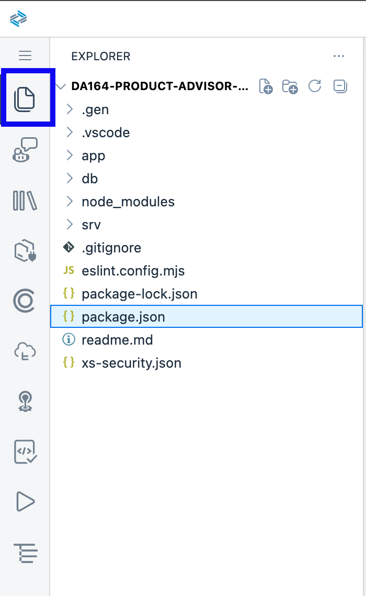

> **What just happened?** SAP Build Code ran `cds init` and created the full CAP project structure: `db/` for data models, `srv/` for services.

> **About extra files the template creates:** You may see `xs-security.json`, `mta.yaml`, and an `app/` folder. These are for MTA deployment — not used in this workshop. Ignore them.
>
> **Important — three things to fix in `package.json`:**
> 1. If you see `"type": "module"` at the top level, **delete that line**. CAP uses CommonJS (`require`) and this setting breaks all service handlers.
> 2. Look inside `"cds"` → `"requires"`. If you see an `"xsuaa"` block, **delete it**. This workshop does not use XSUAA authentication and leaving it in causes **400 Bad Request** errors on your deployed app.
> 3. Add `"outbox": false` inside the `"cds"` section to suppress a harmless but distracting warning about messaging tables this workshop does not use:
> ```json
> "cds": {
>   "outbox": false,
>   "requires": { ... }
> }
> ```

---

> ### ⚠️ If project creation failed in the Build Code lobby
>
> If you saw a **"Project creation failed"** error in Step 2, create the project directly from inside your BAS dev space instead:
>
> 1. In the BAS menu bar, click **Help → Get Started**.
>
> 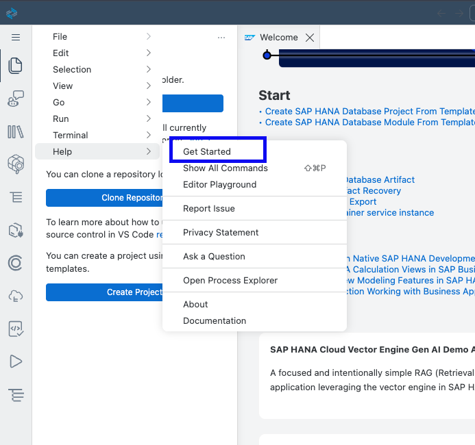
>
> 2. On the Get Started page, click **New Project from Template**.
>
> 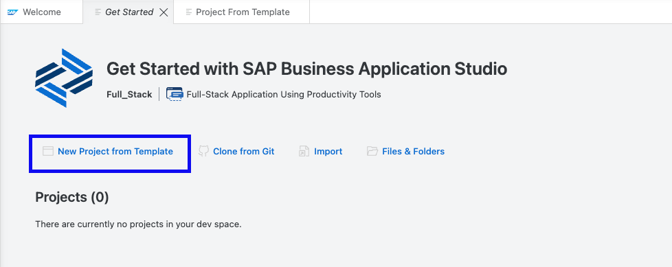
>
> 3. Select the **CAP Project** template. On the details screen, enter your project name (`da164-product-advisor-XXX`), choose **Node.js** as the runtime, leave all deployment and capability checkboxes **unchecked**, and click **Finish**.
>
> 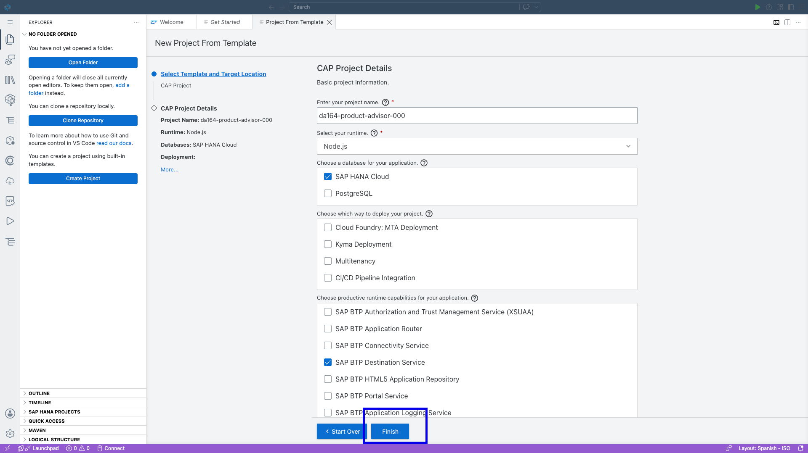
>
> 4. BAS opens the project automatically. You will see the same project structure as above.
>
> 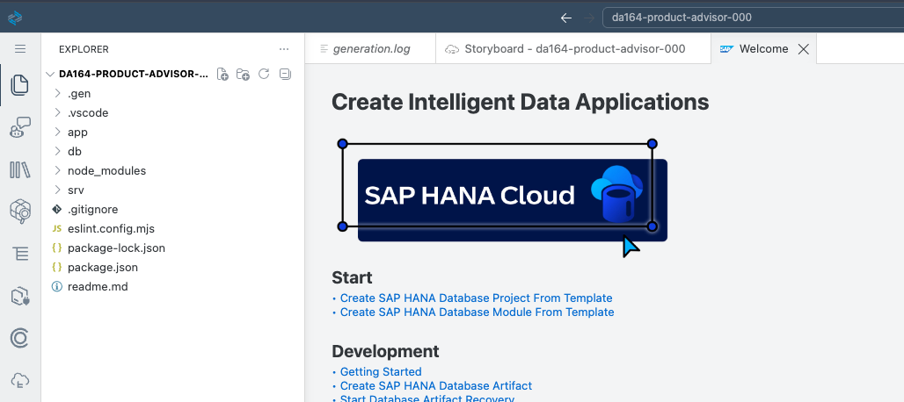
>
> Continue from **Step 3** below.

---

## Step 3 – Install the Additional Dependencies

1. Open a terminal: **Menu → Terminal → New Terminal**.

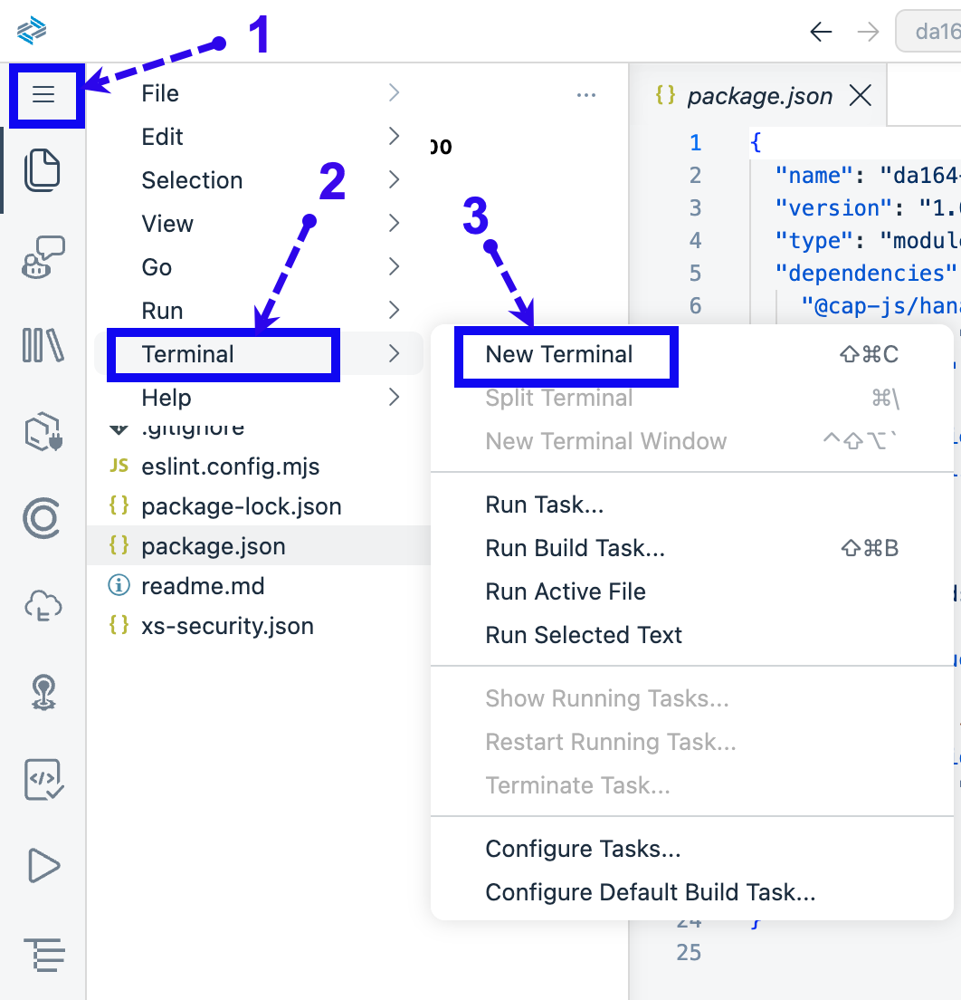

2. Install all project dependencies:

```bash
npm install
```

> **Why `npm install`?** This installs all packages listed in `package.json`, including Express (the HTTP server CAP uses in production). CAP manages the Express version automatically — you don't need to add it explicitly.

> **Note:** You may see `npm audit` warnings about vulnerabilities — these are from indirect dev dependencies and do not affect the workshop. Ignore them.

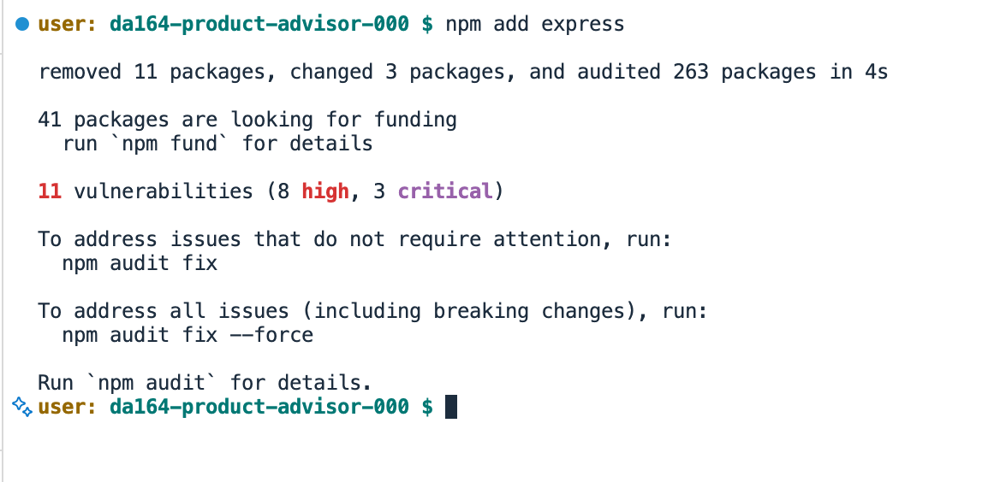

---

## Step 4 – Create the Project Structure

1. Create the folders and files you will need later:

```bash
mkdir -p scripts
touch .env
```

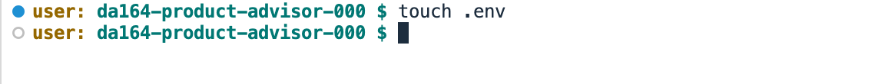

---

## Step 5 – Verify the Project Starts

1. Run:

```bash
cds watch
```

2. You should see output similar to one of these (the exact message depends on your CAP version):

```
cds - server listening on { url: 'http://localhost:4004' }
```

or:

```
[cds] - no models found in db/,srv/,app/
[cds] - waiting for some models ...
```

No red errors is what matters. The URL may not appear if there are no models yet — that is normal at this stage.

3. Press **Ctrl+C** to stop the server.

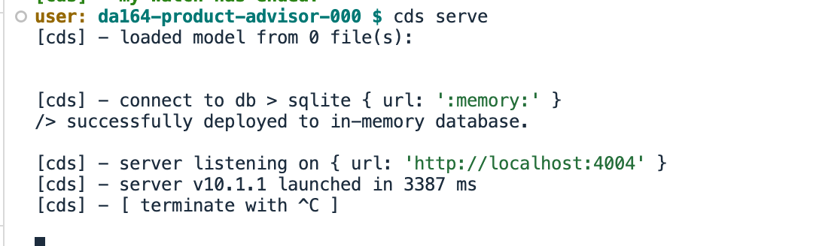

> **If you see an XSUAA or passport error:** stop the server, remove the `"xsuaa"` block from `cds.requires` in `package.json`, then run `cds watch` again.

---

## Summary

Your CAP project is created, dependencies are installed, and the app starts cleanly. You are ready to build.

**Next**: Connect to live S/4HANA product data via a BTP Destination.

Continue to [Exercise 1 – Clean Core & Side-by-Side Extensibility](../ex1/README.md)
