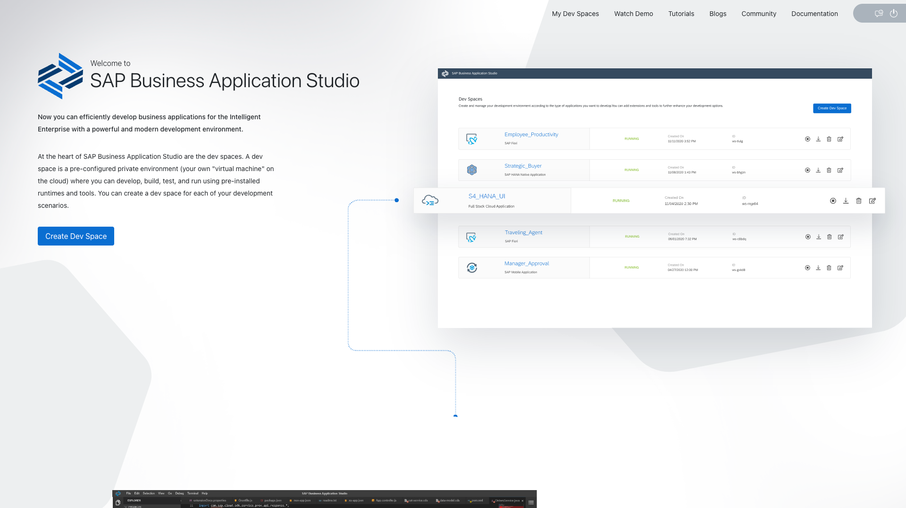
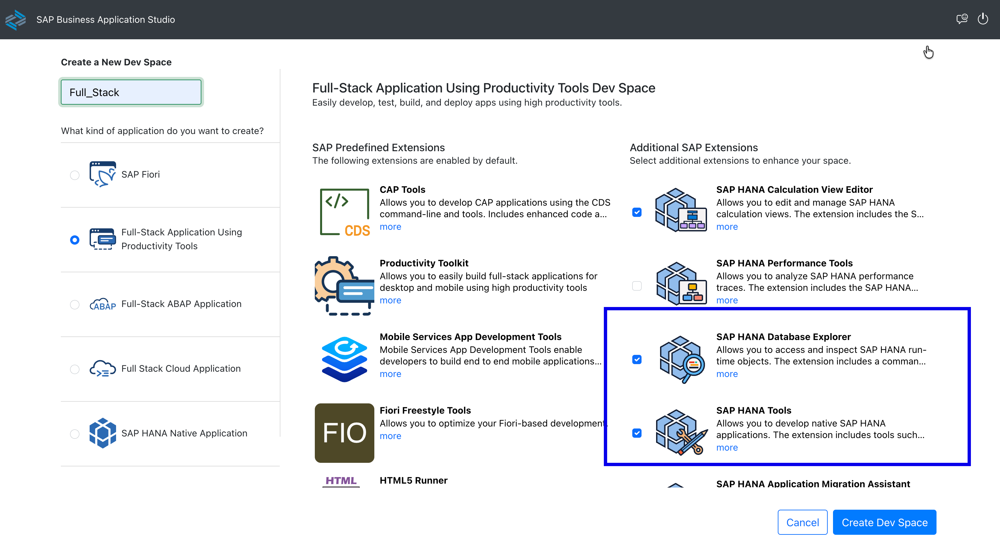
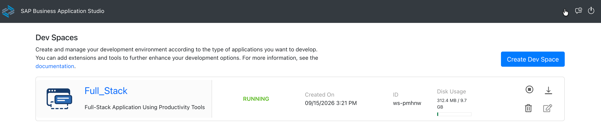
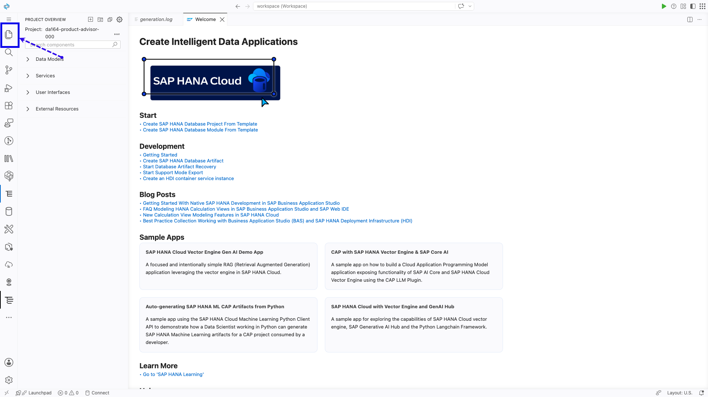
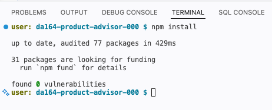

# Getting Started – Create Your Project

Welcome to **DA164 – Build AI Agents and Applications Natively on SAP HANA Cloud**.

In this exercise you will create a fresh CAP project. You will add credentials and external service models in the exercises where they are first needed — nothing else is required right now.

> **The story so far:**
> Maya is a Freight Pricing Specialist at **GlobalFreight AG**, a logistics company running SAP S/4HANA Cloud. Every day she gets dozens of customer inquiries like *"What charges apply for a container held at port past the free period?"* — and each complex inquiry takes 30–45 minutes because S/4HANA's search only works with exact charge codes. By the end of this session you will have built the app that gives her an AI-powered answer in seconds. This exercise creates the project foundation.

---

## Before you begin

Open **SAP Build Code** and log in before starting. Your login details are on your seat card — replace `XXX` with your assigned 3-digit seat number.

| | Value |
|---|---|
| **SAP Build Code URL** | [https://da164.eu10.build.cloud.sap/lobby](https://da164.eu10.build.cloud.sap/lobby) |
| **Username** | `da164-XXX@education.cloud.sap` |
| **Password** | `Acce$$teched26` |

> Your seat number is the 3-digit number at the end of your username (e.g. `da164-007` → seat **007**).

> Everything else (API key, S/4HANA model file) will be introduced at the exercise where it is first used.

---

## Step 1 – Set Up Your Dev Space

Before creating a project you need a BAS dev space. You will create a **Full Stack Cloud Application using Productivity Tools** dev space and add the two HANA extensions needed for this workshop.

1. From the SAP Build Code lobby, open the **Dev Space Manager**.


2. Click **Create Dev Space**.



3. Give it a name (e.g. `Full_Stack`), select **Full Stack Cloud Application using Productivity Tools** as the kind, then check both **SAP HANA Tools** and **SAP HANA Database Explorer** under Additional SAP Extensions.



4. Click **Create Dev Space**. Wait for the status to change to **RUNNING**.


> Do not open BAS yet — come back here and complete Step 2 first so the project is created in the correct dev space.

---

## Step 2 – Create Your Project in SAP Build Code

SAP Build Code is a cloud-based development environment built on SAP Business Application Studio. It has a project wizard that sets up the full CAP project structure for you automatically.

> **If the wizard does not work**: Some participants encounter a "Project creation failed" error in the Build Code lobby. If that happens to you, skip steps 1–7 below and follow the **manual BAS template** instructions in the callout at the end of this step — the result is identical.

1. SAP Build Code should still be open from when you first logged in — switch back to that tab. If your session has expired, log in again using the credentials in the table above.


2. Click the **Create** button in the top area of the lobby.


3. A dialog opens asking what you want to create. Select **Application**.


4. On the next screen, choose **Full Stack Cloud Application** as the template.


5. Choose **Node.js** as the runtime.


6. Enter your project name using your 3-digit seat number:

   - **Project Name**: `da164-product-advisor-001` *(replace `001` with your seat number)*

   Under **Dev Space**, select **Existing** and choose **Full_Stack** from the dropdown — the dev space you created in Step 1. Then click **Review**.


7. The wizard shows the **Summary** screen. Confirm the details and click **Create**.


> ### ⚠️ If project creation failed in the Build Code lobby
>
> If you saw a **"Project creation failed"** error, create the project directly from inside your BAS dev space instead:
>
> First, go back to the **Dev Space Manager** (click the grid/home icon in the top left of the lobby). Find your **Full_Stack** dev space — it should show status **RUNNING**. Click its name to open BAS.
>
> 
>
> 1. In the BAS menu bar, click **Help → Get Started**.
>
> 
>
> 2. On the Get Started page, click **New Project from Template**.
>
> 
>
> 3. Select the **CAP Project** template. On the details screen, enter your project name (`da164-product-advisor-XXX`), choose **Node.js** as the runtime, leave all deployment and capability checkboxes **unchecked**, and click **Finish**.
>
> 
>
> 4. BAS opens the project automatically. You will see the same project structure as above.
>
> 
>
> Continue from **Step 3** below.

8. SAP Build Code creates the project. When it finishes, click on your project to open it in BAS.


> If BAS does not open the project automatically, look for it in the **Explorer** panel. Click the overlapping-pages icon (Explorer) in the left sidebar — your project folder (`da164-product-advisor-XXX`) should appear in the file tree.

9. BAS opens. If it lands on a **Project Overview** or **Storyboard** page, click the **Explorer** icon (the overlapping-pages icon at the top of the left sidebar) to switch to the familiar file tree view.




> **What just happened?** SAP Build Code ran `cds init` and created the full CAP project structure: `db/` for data models, `srv/` for services.

> **About extra files the template creates:** You may see `xs-security.json`, `mta.yaml`, and an `app/` folder. These are for MTA deployment — not used in this workshop. Ignore them.
>
> **Important — three things to fix in `package.json`:**
> 1. If you see `"type": "module"` at the top level, **delete that line**. CAP uses CommonJS (`require`) and this setting breaks all service handlers.
> 2. Look inside `"cds"` → `"requires"`. If you see an `"xsuaa"` block, **delete it**. This workshop does not use XSUAA authentication and leaving it in causes **400 Bad Request** errors on your deployed app.
> 3. Add `"outbox": false` inside the `"cds"` section to suppress a harmless but distracting warning about messaging tables this workshop does not use:
> ```json
> "cds": {
>   "outbox": false,
>   "requires": { ... }
> }
> ```
> **If your `package.json` has no `"cds"` section at all** (this can happen with manual project creation when all capability checkboxes are left unchecked), create the entire block from scratch:
> ```json
> "cds": {
>   "outbox": false,
>   "requires": {}
> }
> ```

---

## Step 3 – Install the Additional Dependencies

1. Open a terminal: **Menu → Terminal → New Terminal**.


2. Install all project dependencies:

```bash
npm install
```

> **Note:** You may see `npm audit` warnings about vulnerabilities — these are from indirect dev dependencies and do not affect the workshop. Ignore them. If a terminal screenshot shows additional commands such as `npm add express`, you can ignore that too — it is not needed for this workshop.



---

## Step 4 – Create the Environment File

1. Create the `.env` file at the project root:

```bash
touch .env
```


---

## Summary

Your CAP project is created and dependencies are installed. You are ready to build.

**Next**: Connect to live S/4HANA product data via a BTP Destination.

Continue to [Exercise 1 – Clean Core & Side-by-Side Extensibility](../ex1/README.md)
