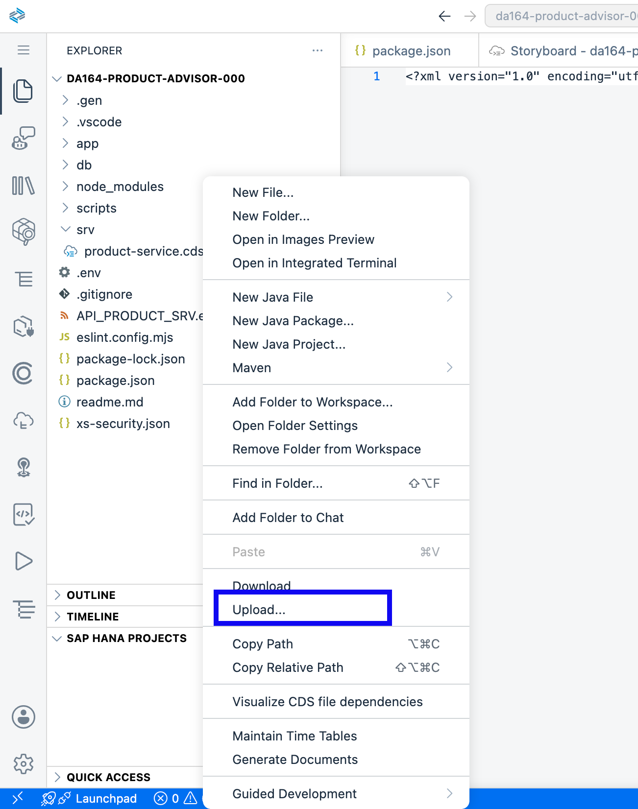
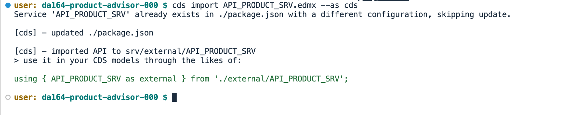
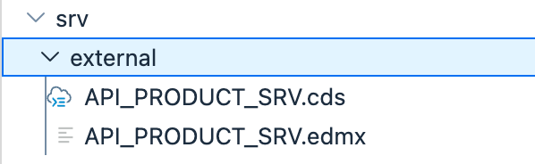
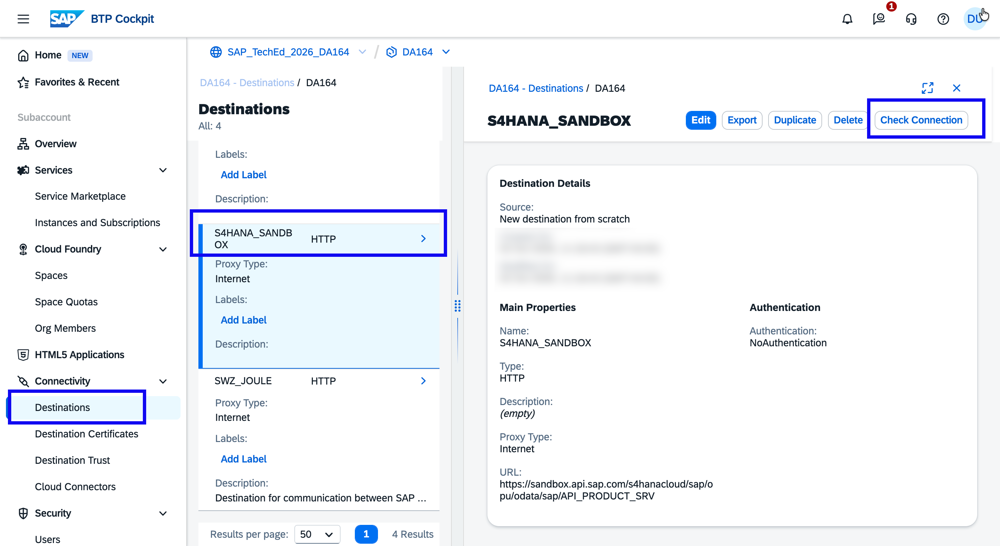
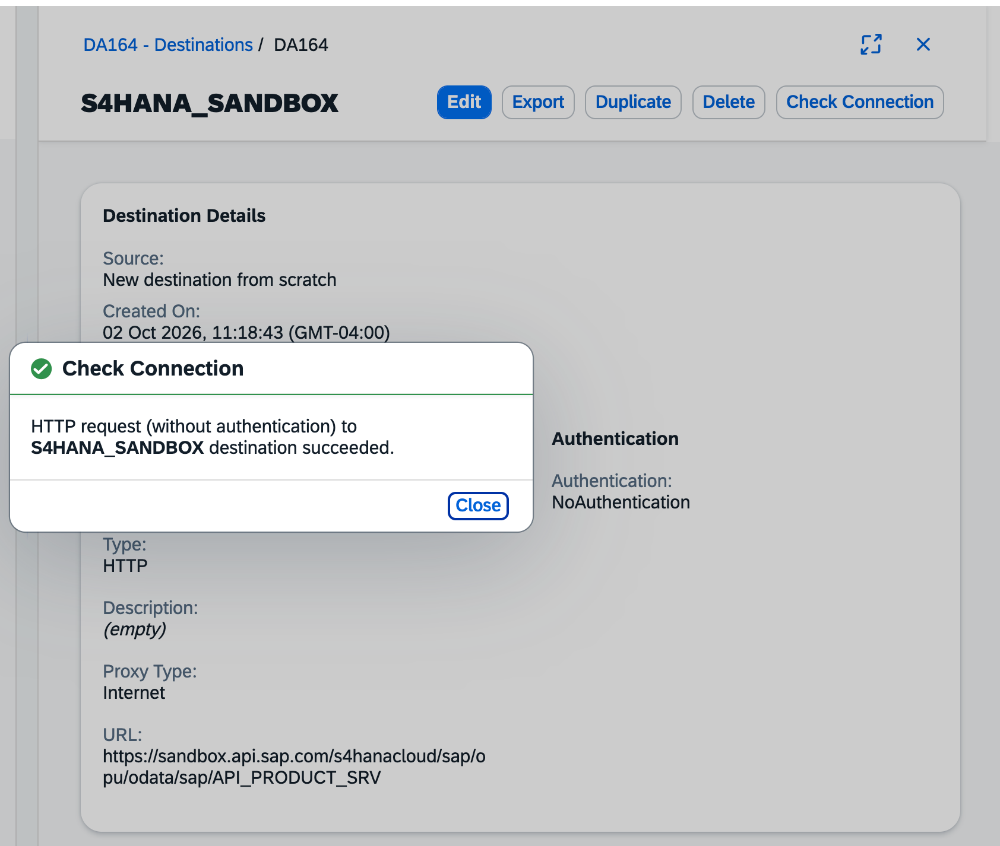
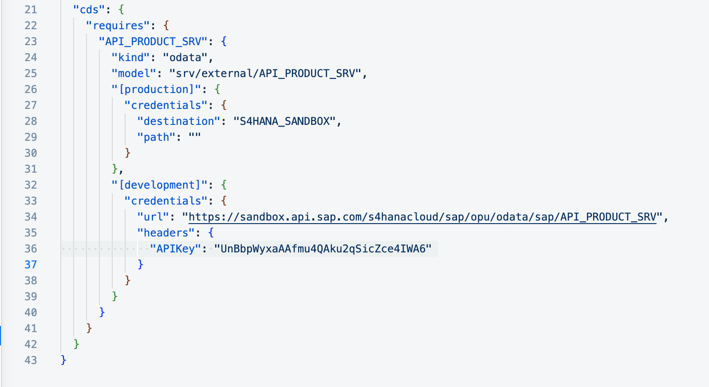
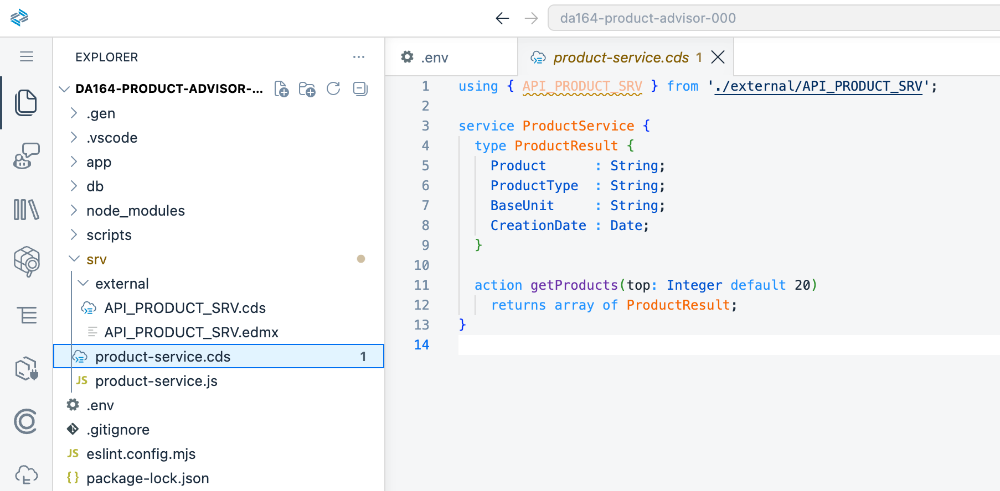
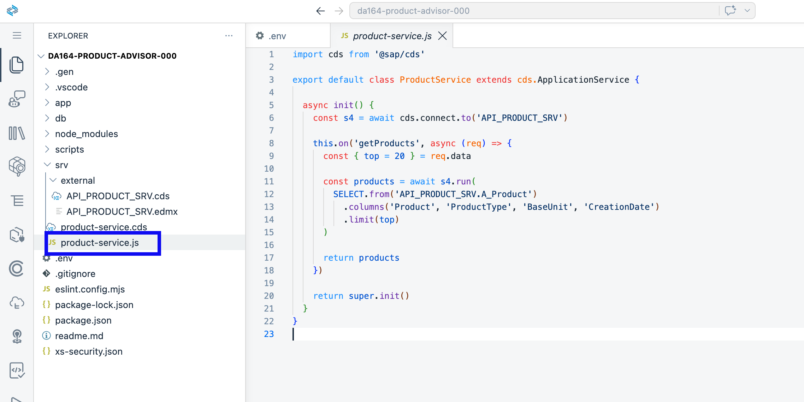
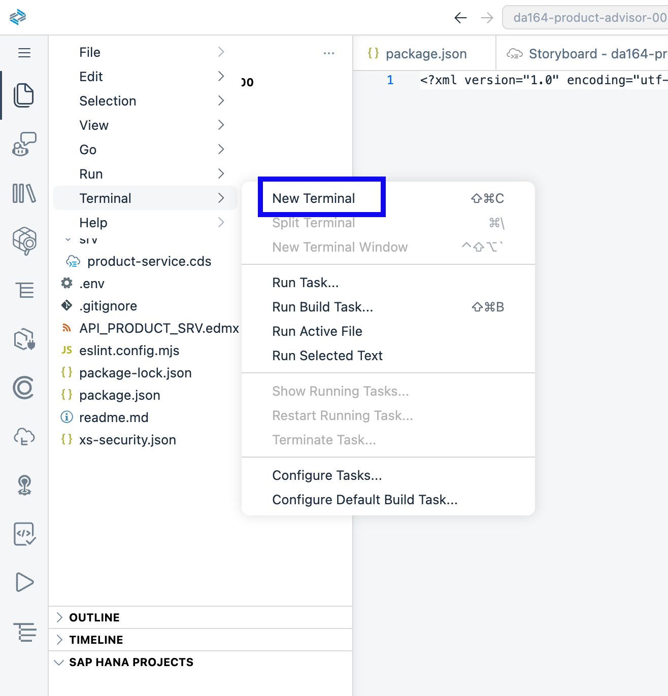
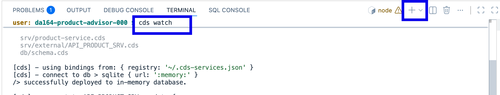

# Exercise 1 – Clean Core & Side-by-Side Extensibility

In this exercise you will connect your app to the SAP S/4HANA Cloud Product API using a **BTP Destination**. You will read live service charge data from S/4HANA — without changing anything inside S/4HANA itself.

> **What does "clean core" mean?**
> The S/4HANA system stays exactly as it is. All your custom logic and AI features live in a separate app on SAP BTP. The two systems talk through a standard API. This is called a **side-by-side extension**.

> **Story context:**
> GlobalFreight AG has a strict clean core policy — no custom code modifications inside S/4HANA. Maya's service charge catalog is locked in there, but you can't touch the system. In this exercise you will use a BTP Destination to read service charge data through a standard API. S/4HANA never knows you added anything. This is the first step: get access to the data without breaking the rules.

---

## What you will do

1. Import the S/4HANA API model into your project
2. Understand the pre-configured BTP Destination for S/4HANA
3. Tell CAP to use that destination when calling the Product API
4. Write code that fetches real product data
5. Test that it works

---

## Step 1 – Import the S/4HANA API Model

CAP needs a local copy of the S/4HANA Product API definition to know the shape of the data. The `API_PRODUCT_SRV.edmx` file is included in this repository — you will download it, upload it to your BAS workspace, and import it into your project.

1. Download [`API_PRODUCT_SRV.edmx`](API_PRODUCT_SRV.edmx) from the `exercises/ex1/` folder in this repository.

   > On GitHub: click the link above → click **Download raw file** (the download icon in the top-right of the file view).

2. In BAS, open the **Explorer** side panel, right-click your **project folder** (`da164-product-advisor-XXX`), and choose **Upload Files**. Select the `.edmx` file you just downloaded.



3. In the terminal, import it into your project:

```bash
cds import API_PRODUCT_SRV.edmx --as cds
```

> If BAS shows a dialog asking to update `package.json`, click **OK**.

This generates two files automatically:
- `srv/external/API_PRODUCT_SRV.cds` — the CDS model CAP uses to call S/4HANA
- `srv/external/API_PRODUCT_SRV.json` — the metadata used at runtime

It also adds a base entry for `API_PRODUCT_SRV` to your `package.json`.





> The API Hub key is provided inline in Step 3 below.

---

## Step 2 – The S/4HANA Destination (Pre-configured)

The `S4HANA_SANDBOX` destination has been created for you by the session owner — **you do not have access to the BTP Cockpit and do not need to do anything here**. This step just explains what was set up so you understand what your CAP app will be connecting to.

In a real project, a BTP admin would go to **BTP Cockpit → Connectivity → Destinations** and create an entry like this:

| Field | Value |
|---|---|
| Name | `S4HANA_SANDBOX` |
| Type | HTTP |
| URL | `https://sandbox.api.sap.com/s4hanacloud/sap/opu/odata/sap/API_PRODUCT_SRV` |
| Authentication | NoAuthentication |
| `URL.headers.APIKey` | An API key for the SAP Business Accelerator Hub sandbox |
| `sap-client` | `100` |

> **Why a destination?**
> Instead of hardcoding the S/4HANA URL and API key into your app, you register them once as a named BTP Destination. Your CAP app then refers to this name — `S4HANA_SANDBOX` — and BTP handles the connection details at runtime. If the URL or credentials ever change, only the destination needs updating.

The screenshots below show what this looks like in the BTP Cockpit — for reference only.





---

## Step 3 – Configure CAP to Use the Destination

1. Back in BAS, open `package.json` in your project root.

2. Find the `"cds"` section — it was created automatically when SAP Build Code set up your project. You do not need to run any command.

   Inside `"cds"`, find the `"requires"` key (or add it if it is not there). **Add the `API_PRODUCT_SRV` block inside `"requires"`** — paste it alongside any existing entries, do not replace the whole `"cds"` section:

```json
"API_PRODUCT_SRV": {
  "kind": "odata",
  "model": "srv/external/API_PRODUCT_SRV",
  "[production]": {
    "credentials": {
      "destination": "S4HANA_SANDBOX",
      "path": ""
    }
  },
  "[development]": {
    "credentials": {
      "url": "https://sandbox.api.sap.com/s4hanacloud/sap/opu/odata/sap/API_PRODUCT_SRV",
      "headers": { "APIKey": "<YOUR_API_HUB_KEY>" }
    }
  }
}
```

   Replace `<YOUR_API_HUB_KEY>` with:

```
UnBbpWyxaAAfmu4QAku2qSicZce4IWA6
```

   After the edit, your `"cds"` section should look like this:

```json
"cds": {
  "outbox": false,
  "requires": {
    "API_PRODUCT_SRV": {
      "kind": "odata",
      "model": "srv/external/API_PRODUCT_SRV",
      "[production]": {
        "credentials": {
          "destination": "S4HANA_SANDBOX",
          "path": ""
        }
      },
      "[development]": {
        "credentials": {
          "url": "https://sandbox.api.sap.com/s4hanacloud/sap/opu/odata/sap/API_PRODUCT_SRV",
          "headers": { "APIKey": "UnBbpWyxaAAfmu4QAku2qSicZce4IWA6" }
        }
      }
    }
  }
}
```

   > **What does this do?** In `[development]` mode (`cds watch`) CAP calls the S/4HANA sandbox directly using the API key. In `[production]` mode (deployed to CF) it uses the `S4HANA_SANDBOX` BTP Destination instead — no credentials in code.



---

## Step 4 – Create the Service Definition

1. Create a new file `srv/product-service.cds` and add:

```cds
using { API_PRODUCT_SRV } from './external/API_PRODUCT_SRV';

service ProductService {
  type ProductResult {
    Product      : String;
    ProductType  : String;
    BaseUnit     : String;
    CreationDate : Date;
  }

  action getProducts(top: Integer default 20)
    returns array of ProductResult;
}
```



> You are defining a CAP service with one action. In Exercise 2 you will expand this file with more entities and actions as the app grows.

---

## Step 5 – Create the Service Handler

1. Create a new file `srv/product-service.js` and add:

```js
import cds from '@sap/cds'

export default class ProductService extends cds.ApplicationService {

  async init() {
    const s4 = await cds.connect.to('API_PRODUCT_SRV')

    this.on('getProducts', async (req) => {
      const { top = 20 } = req.data

      const products = await s4.run(
        SELECT.from('API_PRODUCT_SRV.A_Product')
          .columns('Product', 'ProductType', 'BaseUnit', 'CreationDate')
          .limit(top)
      )

      return products
    })

    return super.init()
  }
}
```

> **How does CAP find this handler?** CAP automatically links `product-service.js` to `product-service.cds` because they share the same filename. No registration or annotation is needed — the names must match. If you ever rename one, rename the other too, or CAP will not call your handler.



---

## Step 6 – Test It

1. In the terminal, restart the app:

```bash
cds watch
```

2. Open a second terminal tab. Go to **Terminal → New Terminal** in the menu bar:



Then run:

```bash
curl -X POST http://localhost:4004/odata/v4/product/getProducts \
  -H "Content-Type: application/json" \
  -d '{"top": 5}'
```

3. You should see real product records coming back from S/4HANA:

```json
[
  { "Product": "21",  "ProductType": "SERV", "CreationDate": "2016-10-17", "BaseUnit": "H"  },
  { "Product": "68",  "ProductType": "MAT",  "CreationDate": "2017-03-27", "BaseUnit": "KG" },
  { "Product": "71",  "ProductType": "ROH",  "CreationDate": "2017-04-11", "BaseUnit": "KG" },
  { "Product": "221", "ProductType": "SERV", "CreationDate": "2022-01-27", "BaseUnit": "AU" },
  { "Product": "231", "ProductType": "SERV", "CreationDate": "2022-01-30", "BaseUnit": "AU" }
]
```



> **Notice**: This is live S/4HANA data. And you never touched the S/4HANA system — that is clean core.

---

## Summary

You now have:
- A BTP Destination connecting your app to the S/4HANA Cloud Product API
- A working CAP handler that reads live product data
- Zero modifications to S/4HANA

**Next**: Store this product data in SAP HANA Cloud and add your own extension fields.

Continue to [Exercise 2 – Extend & Persist in SAP HANA Cloud](../ex2/README.md)
