# Exercise 2 – Extend & Persist in SAP HANA Cloud

In this exercise you will create a table in SAP HANA Cloud to store service charge data from S/4HANA — plus extra fields that don't exist in S/4HANA, like an AI summary and a vector column for search. Then you will copy the service charges into that table.

> **Why store a copy?**
> Calling S/4HANA on every request is fine for basic reads, but you can't do AI-powered search directly on S/4HANA data. By keeping a copy in HANA Cloud, you can add custom fields and run vector searches on your own terms — without touching S/4HANA.

> **Story context:**
> You have access to S/4HANA service charge data — but S/4HANA has no room for AI fields like embeddings or summaries. In this exercise you will create your own service charge table in HANA Cloud that holds everything S/4HANA has *plus* the AI fields you'll need later. Think of it as giving Maya's team their own working copy of the catalog, ready to be enriched.

---

## What you will do

1. Define a product extension table in your CDS schema
2. Connect the app to SAP HANA Cloud
3. Update the service definition to include new actions
4. Write the code that copies products from S/4HANA into HANA Cloud
5. Run the sync and check the result

---

## Step 1 – Define the Extension Table

> **Before you start**: If `cds watch` is still running from Exercise 1, press **Ctrl+C** in that terminal to stop it now. Running two CDS watch instances at the same time causes a port conflict.

1. Create the file `db/schema.cds` with the following content:

```cds
namespace products;

entity ProductExtension {
  key Product     : String(40);
      ProductType : String(4);
      Description : String(500);
      BaseUnit    : String(3);
      AISummary   : String(1000);
      Embedding   : Vector(768);
}
```

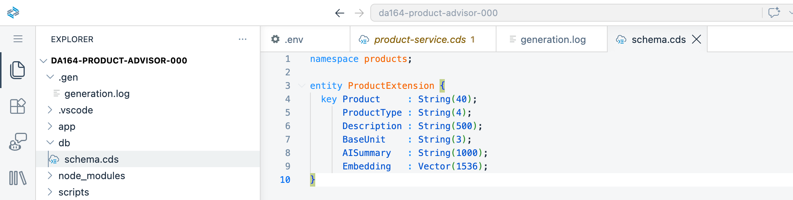

> **What are these fields?**
> `Product`, `ProductType`, `Description`, and `BaseUnit` come from S/4HANA. `AISummary` and `Embedding` are new fields that only exist in your extension — they will be filled in by AI in Exercise 3.

---

## Step 2 – Add SAP HANA Cloud as the Database

1. In the terminal, run:

```bash
cds add hana,mta
```

```bash
npm install
```

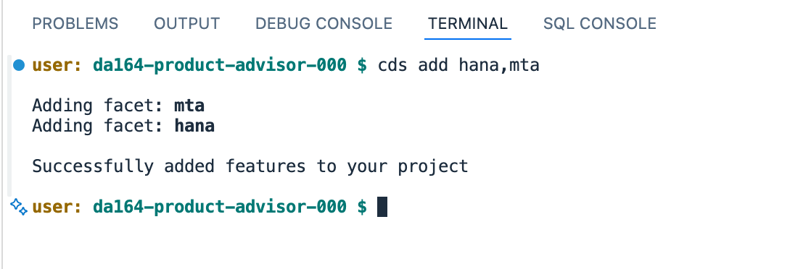

2. Log in to Cloud Foundry using the BAS Cloud Foundry panel. In the BAS menu bar, go to **View → Cloud Foundry**.

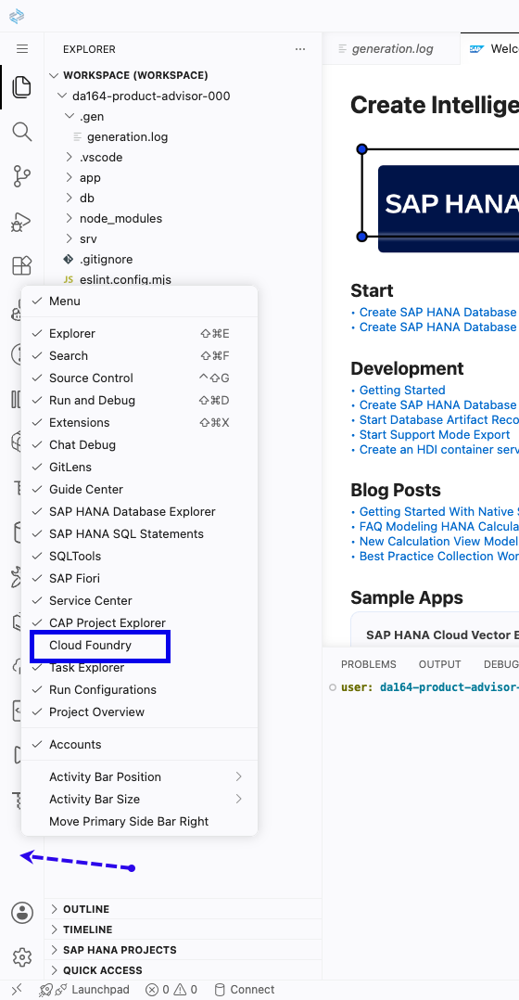

   The Cloud Foundry panel opens on the left. It shows **Login required** — click the **→** login button.

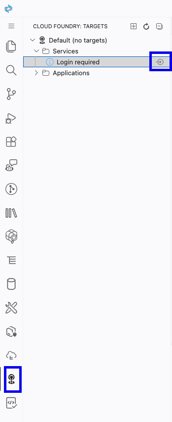

   A dialog appears at the top of BAS. Enter the CF API endpoint when prompted:

   ```
   https://api.cf.eu10-005.hana.ondemand.com
   ```

   When asked for the authentication method, select **SSO Passcode**. A URL is shown — open it in your browser.

3. In the browser, log in with your workshop credentials (`da164-XXX@education.cloud.sap`) if prompted. If the page shows multiple identity providers, select **tdct3ched1**. Copy the temporary passcode shown on the page.


4. Paste the passcode into the BAS prompt and press Enter. Select org `da164` and space `dev` when prompted.


5. Create your personal HDI container — **replace `001` with your 3-digit seat number** (from your login username, e.g. `da164-0042` → `042`):

```bash
cf create-service hana hdi-shared da164-hdi-001
```

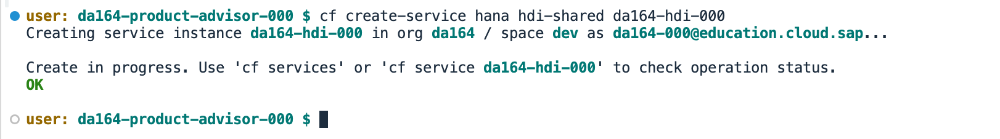

The service takes about 30 seconds to provision. Check that it is ready before continuing:

```bash
cf service da164-hdi-001
```

Wait until `status` shows **create succeeded** (not "create in progress").

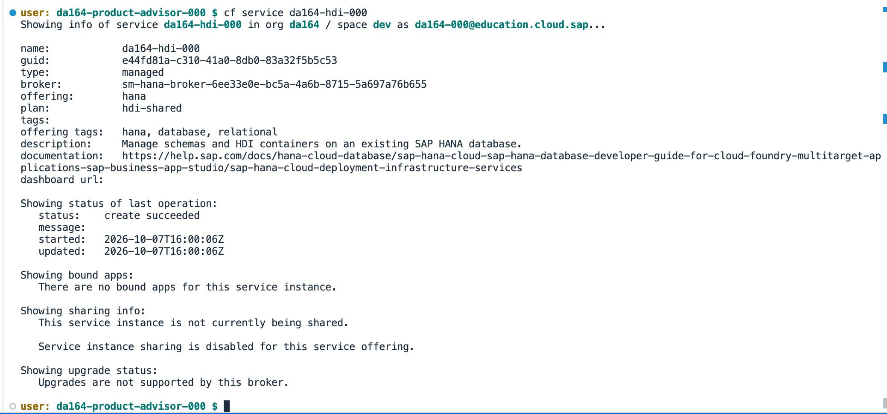

6. Bind the service to your local CDS session so CDS knows which HANA container to use:

```bash
cds bind --to da164-hdi-001
```

> This writes connection details to `.cdsrc-private.json` in your project root (gitignored by default). CDS picks this up automatically for local runs.

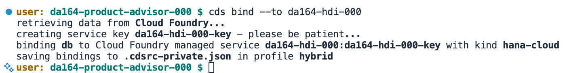

   After the command completes, scroll down in the Explorer sidebar to the **SAP HANA PROJECTS** panel. Expand your project — you should see `da164-hdi-001` listed under **Database Connections**.

   > **If the container is not listed**, bind it manually:
   > 1. Hover over the **Database Connections** row — a binding icon appears on the right. Click it.
   > 2. A dialog appears. Select **Bind to an HDI container**.
   >
   > 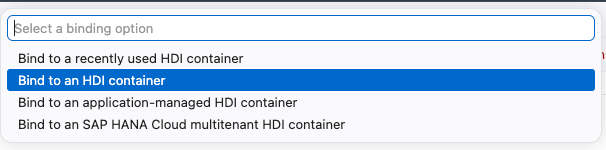
   >
   > 3. A service list appears. Select `da164-hdi-001` (your seat number).
   >
   > 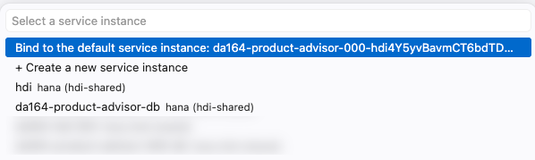
   >
   > The container now appears under **Database Connections** with a cube icon.
   >
   > 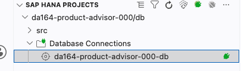
   >
   > You will use this cube icon in Exercise 3 to open the Database Explorer directly from BAS.

7. Deploy the table schema to your HANA container:

```bash
cds deploy --to hana
```

Look for this in the output:

```
Tables deployed: products_ProductExtension
Deploy done.
```

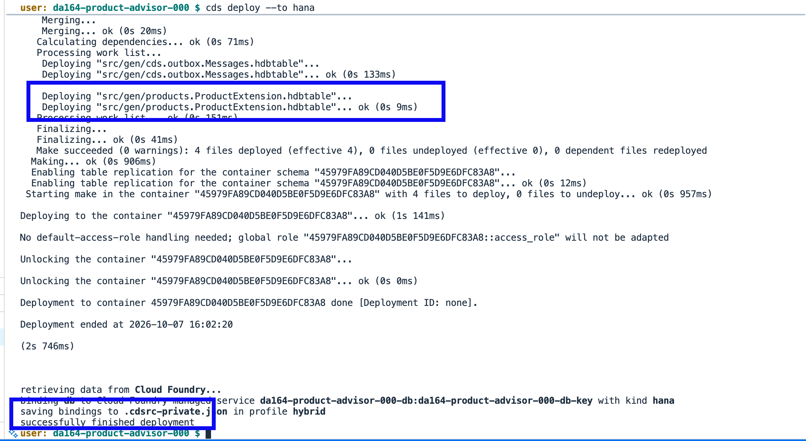

8. Verify the app is now using HANA as the database:

```bash
cds watch --profile hybrid
```

You should see `connect to db > hana` in the log — not `sqlite`.

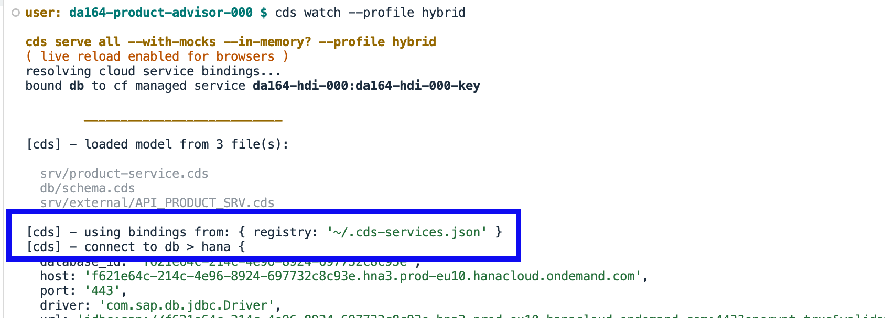

---

## Step 3 – Update the Service Definition

1. Open [srv/product-service.cds](../../srv/product-service.cds).

2. Replace the content with:

```cds
using { API_PRODUCT_SRV } from './external/API_PRODUCT_SRV';
using { products }         from '../db/schema';

service ProductService {
  entity Products as projection on products.ProductExtension
    excluding { Embedding };

  action getProducts(top: Integer default 20) returns array of {
    Product:     String;
    ProductType: String;
    BaseUnit:    String;
  };

  action syncProducts()
    returns { synced: Integer };

  action hybridSearch(query: String, top: Integer default 5)
    returns array of Products;

  action askAdvisor(question: String)
    returns { answer: String };
}
```

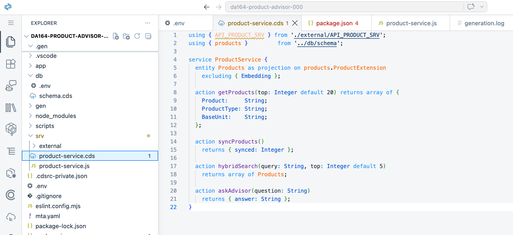

> You are adding four actions. You already built `getProducts` in Exercise 1. You will build `syncProducts` now, and `hybridSearch` and `askAdvisor` in the next exercises.

3. Now that the service definition has changed, deploy again to write the updated views to HANA:

```bash
cds deploy --to hana
```


---

## Step 4 – Write the Sync Handler

1. Open [srv/product-service.js](../../srv/product-service.js) and **replace the entire file** with:

```js
import cds from '@sap/cds'

export default class ProductService extends cds.ApplicationService {

  async init() {
    const s4 = await cds.connect.to('API_PRODUCT_SRV')

    this.on('getProducts', async (req) => {
      const { top = 20 } = req.data
      return s4.run(
        SELECT.from('API_PRODUCT_SRV.A_Product')
          .columns('Product', 'ProductType', 'BaseUnit', 'CreationDate')
          .limit(top)
      )
    })

    this.on('syncProducts', async (req) => {
      const rawProducts = await s4.run(
        SELECT.from('API_PRODUCT_SRV.A_Product')
          .columns('Product', 'ProductType', 'BaseUnit')
          .limit(50)
      )

      let synced = 0
      for (const p of rawProducts) {
        const [desc] = await s4.run(
          SELECT.from('API_PRODUCT_SRV.A_ProductDescription')
            .columns('ProductDescription')
            .where({ Product: p.Product, Language: 'EN' })
        )

        await UPSERT.into('products.ProductExtension').entries({
          Product:     p.Product,
          ProductType: p.ProductType,
          BaseUnit:    p.BaseUnit,
          Description: desc?.ProductDescription ?? p.Product
        })
        synced++
      }

      return { synced }
    })

    return super.init()
  }
}
```

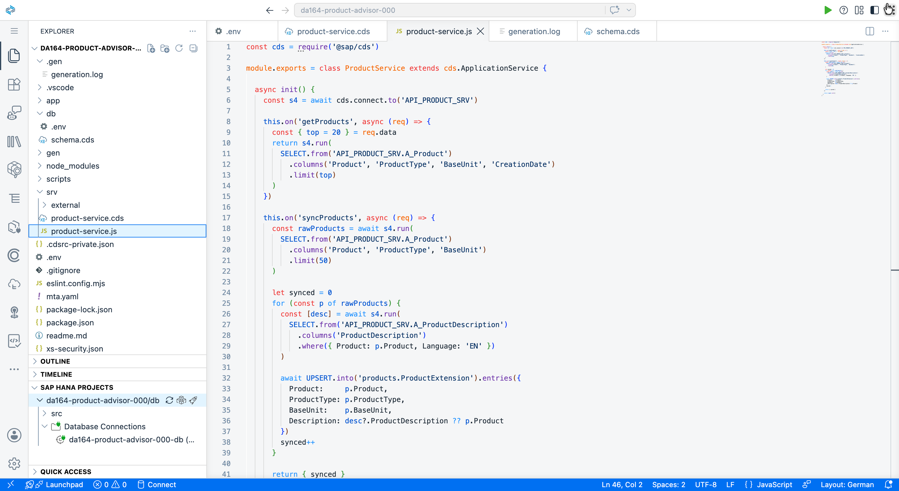

---

## Step 5 – Run the Sync

1. Make sure `cds watch --profile hybrid` is still running in your first terminal. If you stopped it, start it again:

```bash
cds watch --profile hybrid
```

2. Open a **new terminal tab** (`+` icon in the terminal panel) and call the sync action:

```bash
curl -X POST http://localhost:4004/odata/v4/product/syncProducts \
  -H "Content-Type: application/json" \
  -d '{}'
```

You should see:

```json
{ "synced": 50 }
```

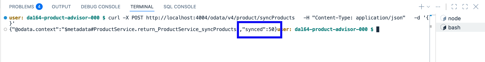

3. Check that the products are stored in HANA by querying the `Products` entity:

```bash
curl "http://localhost:4004/odata/v4/product/Products?\$top=5"
```

You should see product rows with `Product`, `ProductType`, `Description`, and `BaseUnit` filled in. The `AISummary` column is empty for now — you will fill it in Exercise 3.

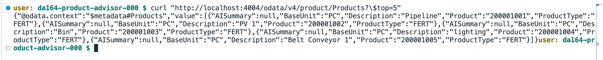

---

## Summary

You now have:
- A product extension table in SAP HANA Cloud with your own extra fields
- A `syncProducts` action that copies 50 products from S/4HANA into HANA Cloud
- The data ready for AI enrichment in the next exercise

**Next**: Explore your data in the HANA Database Explorer and generate AI embeddings.

Continue to [Exercise 3 – Enrich Products with AI Embeddings](../ex3/README.md)
