# Exercise 3 – Enrich Products with AI Embeddings

In this exercise you will open the **SAP HANA Database Explorer** — a browser-based SQL tool built into HANA Cloud — to look at the table you created in Exercise 2. Then you will run a script that generates AI embeddings for all service charge descriptions and stores them in the `Embedding` column.

> **What is an embedding?**
> An embedding is a list of numbers that captures the *meaning* of a piece of text. Two descriptions that mean something similar will have similar numbers — even if they use completely different words. HANA Cloud stores these natively in a `REAL_VECTOR` column so you can search by meaning in Exercise 4.

> **Story context:**
> Service charge descriptions in S/4HANA are written in shorthand for logistics experts, not customers. *"Demurrage/Detention Charges"* doesn't help a customer asking *"what do I pay if my container sits at the port longer than expected?"*. In this exercise you will generate AI embeddings that encode the *meaning* of every service charge description — so HANA can later find charges by what they cover, not just by the words used to name them. This is the step that makes Maya's problem solvable.

---

## What you will do

1. Open the HANA Database Explorer from BTP
2. Browse your product table and inspect its columns
3. Run a few SQL queries to explore the data
4. Run the embedding script to fill the `Embedding` column
5. Verify the embeddings are stored correctly

---

## Step 1 – Open HANA Database Explorer

1. In BAS, look at the bottom of the left sidebar. Find the **SAP HANA PROJECTS** panel. Expand your project's `db` entry — you will see **Database Connections** with your HDI container listed. Click the **cube icon** (Database Explorer) on the right side of the row.

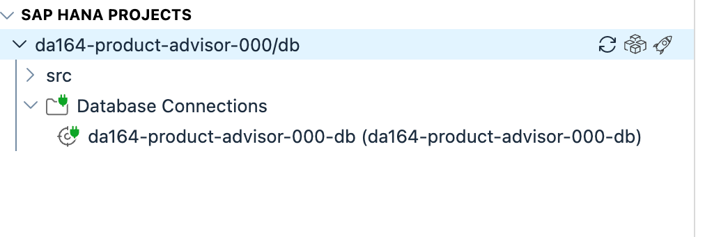

2. BAS asks whether to open an external website. Click **Open**.

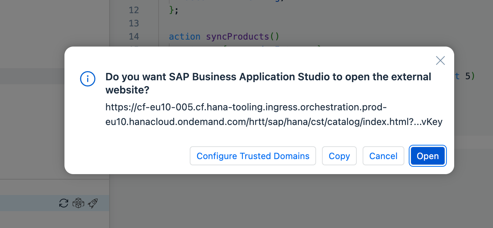

3. A browser tab opens with the BTP login page. Click **Sign in with default identity provider**.

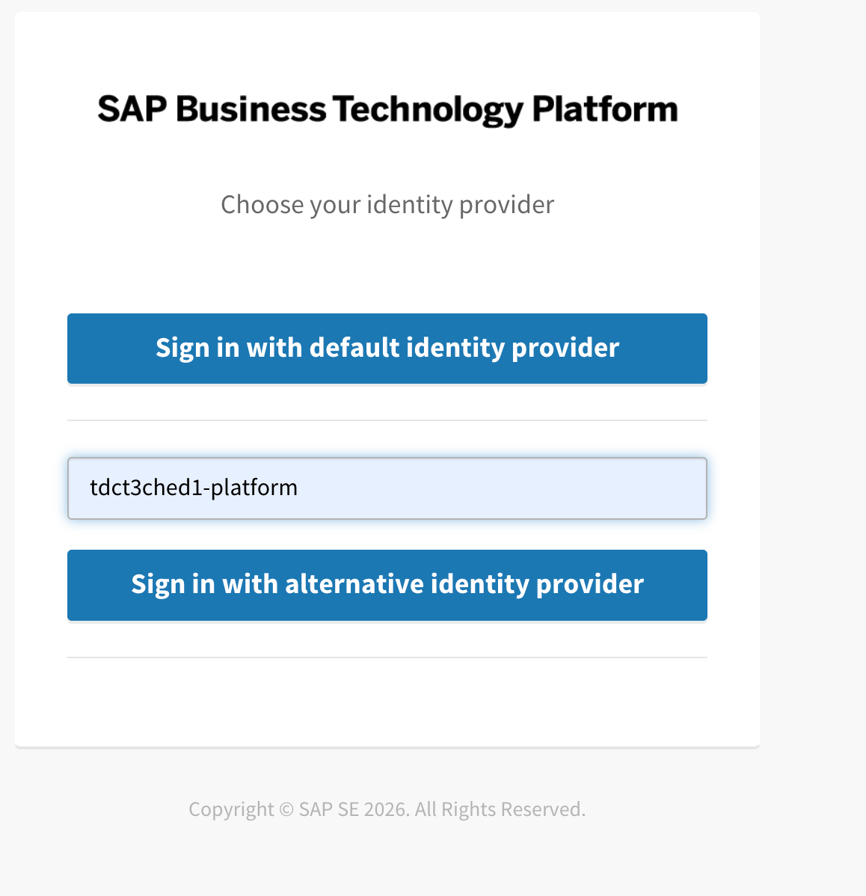

4. An application authorization page appears. Click **Authorize**.

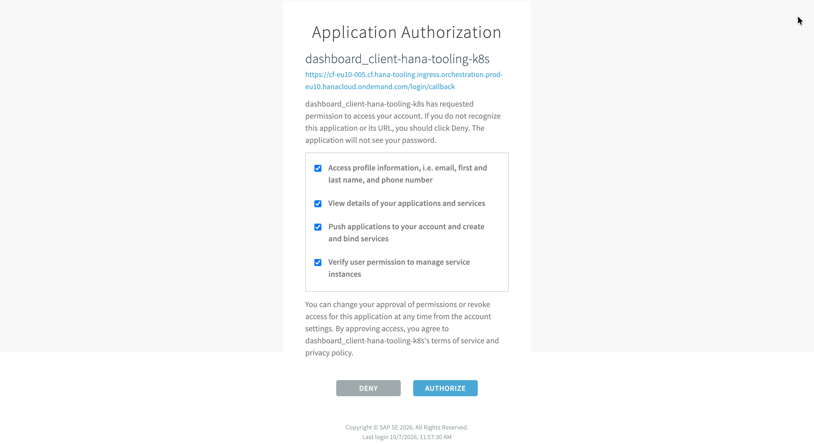

5. The HANA Database Explorer loads.


---

## Step 2 – Find Your Product Table

1. In the left panel, expand **Tables**. You will see `PRODUCTS_PRODUCTEXTENSION` listed.

2. Click `PRODUCTS_PRODUCTEXTENSION` to open it. Then click **Open Data** to see the rows.

You should see the 50 product rows you synced in Exercise 2, with `AISUMMARY` and `EMBEDDING` empty for now.

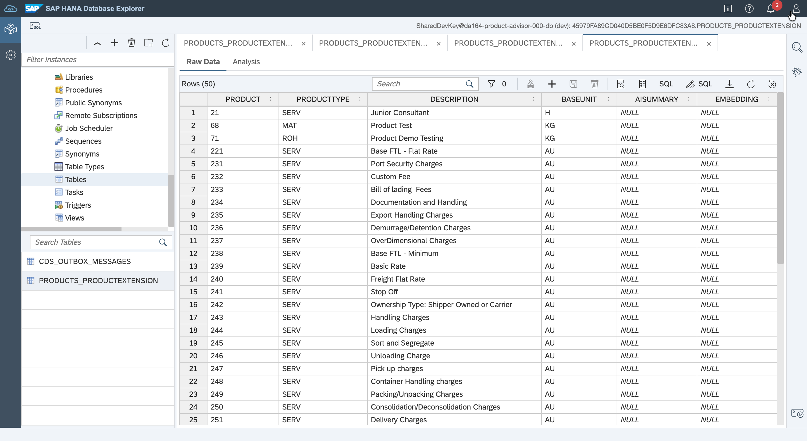

---

## Step 3 – Inspect the Table Structure

1. Click on `PRODUCTS_PRODUCTEXTENSION` in the left panel. The column definitions open on the right.

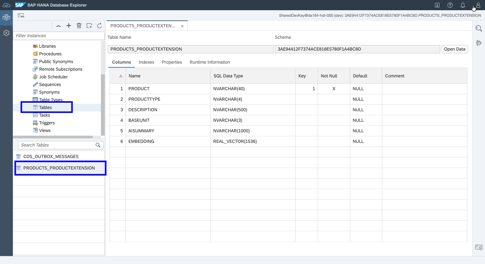

Confirm you can see these columns:

| Column | Type |
|---|---|
| `PRODUCT` | NVARCHAR(40) |
| `DESCRIPTION` | NVARCHAR(500) |
| `AISUMMARY` | NVARCHAR(1000) |
| `EMBEDDING` | REAL_VECTOR(1536) |

> The `REAL_VECTOR(1536)` type is HANA Cloud's built-in vector column. It stores 1536 numbers per row — one for each dimension of the AI embedding.

---

## Step 4 – Run Some SQL Queries

1. Right-click on your database connection in the left panel and choose **Open SQL Console**.

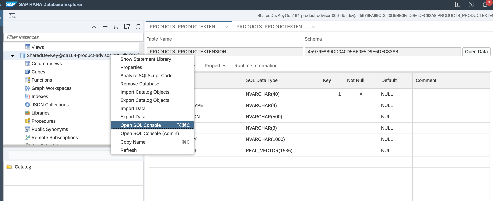

2. Count how many products you have:

```sql
SELECT COUNT(*) AS TOTAL FROM PRODUCTS_PRODUCTEXTENSION;
```

Click the **Run** button (green triangle). The result should show `50`.

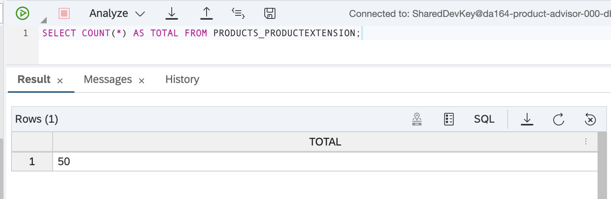

3. Preview the descriptions:

```sql
SELECT PRODUCT, PRODUCTTYPE, LEFT(DESCRIPTION, 80) AS DESCRIPTION
FROM PRODUCTS_PRODUCTEXTENSION
ORDER BY PRODUCT
LIMIT 10;
```

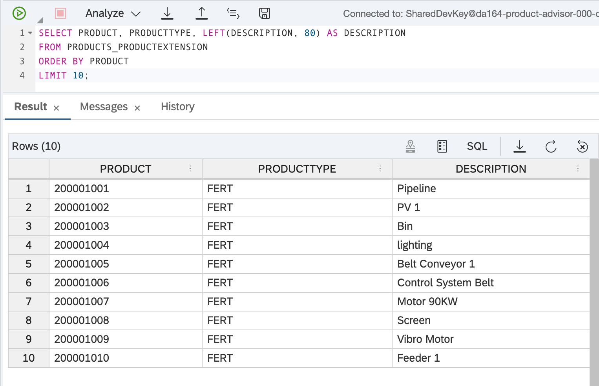

---

## Step 5 – Set Up the AI Core Client

Before generating embeddings you need two things: the AI Core client code and your credentials.

1. Create the file `srv/ai-core-client.js` with the following content:

```js
const { readFileSync } = require('fs')
const cfg = JSON.parse(readFileSync('.aicore/config.json'))

const apibase = cfg.serviceurls.AI_API_URL
const aiHeaders = {
  'Content-Type':      'application/json',
  'AI-Resource-Group': cfg.resourceGroup ?? 'default'
}

let _token = null
let _tokenExpiry = 0

async function getToken() {
  if (_token && Date.now() < _tokenExpiry) return _token
  const res = await fetch(`${cfg.url}/oauth/token`, {
    method: 'POST',
    headers: { 'Content-Type': 'application/x-www-form-urlencoded' },
    body: new URLSearchParams({
      grant_type:    'client_credentials',
      client_id:     cfg.clientid,
      client_secret: cfg.clientsecret
    })
  })
  const data = await res.json()
  _token = data.access_token
  _tokenExpiry = Date.now() + (data.expires_in - 60) * 1000
  return _token
}

async function getEmbedding(text) {
  const token = await getToken()
  const res = await fetch(
    `${apibase}/v2/inference/deployments/${cfg.embedDeploymentId}/v1/embeddings`,
    {
      method: 'POST',
      headers: { ...aiHeaders, Authorization: `Bearer ${token}` },
      body: JSON.stringify({ input: text })
    }
  )
  const data = await res.json()
  return data.data[0].embedding
}

async function chatCompletion(messages) {
  const token = await getToken()
  const res = await fetch(
    `${apibase}/v2/inference/deployments/${cfg.deploymentId}/completion`,
    {
      method: 'POST',
      headers: { ...aiHeaders, Authorization: `Bearer ${token}` },
      body: JSON.stringify({
        orchestration_config: {
          module_configurations: {
            llm_module_config: {
              model_name: cfg.model_chat,
              model_params: { max_tokens: 500 }
            },
            templating_module_config: { template: messages }
          }
        }
      })
    }
  )
  const data = await res.json()
  return data.orchestration_result.choices[0].message.content
}

module.exports = { getEmbedding, chatCompletion }
```

2. Save the file.

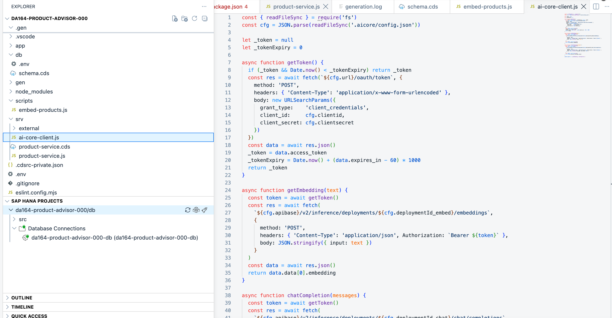

3. Create the credentials file. In the terminal:

```bash
mkdir -p .aicore
```

4. Open the file [resources/aicore-config.json](../../resources/aicore-config.json) in this repository. Copy its contents and create `.aicore/config.json` in your project with the same content.

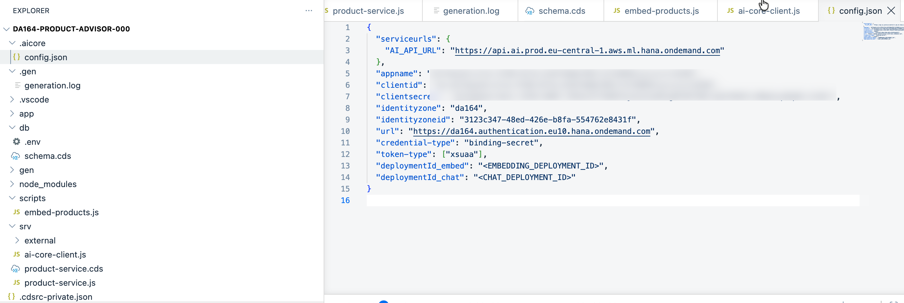

> **Important**: `.aicore/` should be added to your `.gitignore` so these credentials are not committed. The copy in this repository is the workshop-provided credentials — do not share them outside the session.

---

## Step 6 – Generate Embeddings

1. Create the file `scripts/embed-products.js` with the following content:

```js
const cds = require('@sap/cds')
const { getEmbedding } = require('../srv/ai-core-client')

async function main() {
  const db = await cds.connect.to('db')

  const products = await db.run(
    SELECT.from('products.ProductExtension')
      .columns('Product', 'Description')
      .where('Embedding is null')
  )

  console.log(`Generating embeddings for ${products.length} products...`)

  for (const p of products) {
    const id   = p.PRODUCT
    const desc = p.DESCRIPTION ?? ''
    const vector = await getEmbedding(`Product: ${id}. ${desc}`)
    const vectorStr = '[' + vector.map(n => n.toFixed(8)).join(',') + ']'
    await db.run(
      `UPDATE PRODUCTS_PRODUCTEXTENSION SET EMBEDDING = TO_REAL_VECTOR('${vectorStr}') WHERE PRODUCT = '${id}'`
    )
    process.stdout.write('.')
  }

  console.log('\nDone.')
}

main().catch(console.error)
```

2. Save the file.

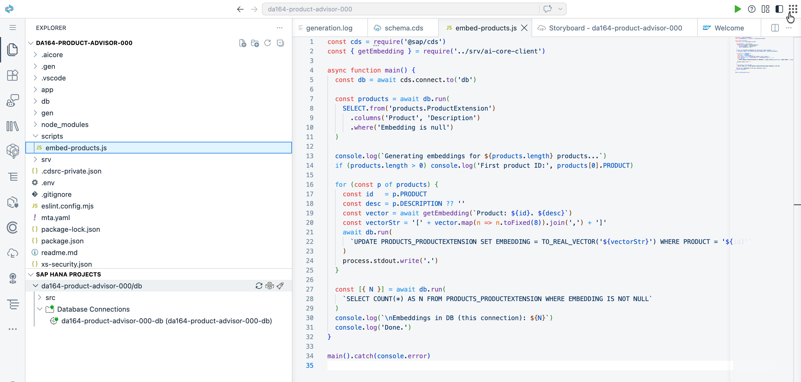

3. In the terminal, run the script:

```bash
cds bind --exec -- node scripts/embed-products.js
```

> `cds bind --exec` injects your HANA Cloud credentials into the process so the script can connect — the same connection `cds watch --profile hybrid` uses. One dot is printed per product. It takes about 20–30 seconds for all 50.

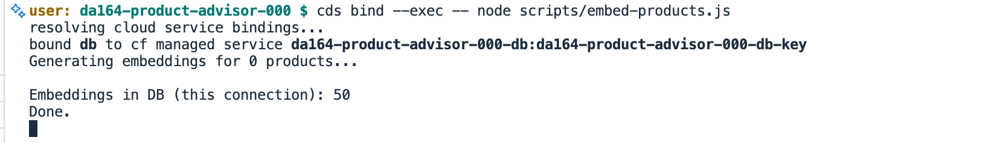

---

## Step 7 – Verify in Database Explorer

Switch back to the **HANA Database Explorer** and run these queries in the SQL Console.

**Check how many embeddings were stored:**

```sql
SELECT
  COUNT(CASE WHEN EMBEDDING IS NOT NULL THEN 1 END) AS WITH_EMBEDDING,
  COUNT(*) AS TOTAL
FROM PRODUCTS_PRODUCTEXTENSION;
```

Both numbers should match.

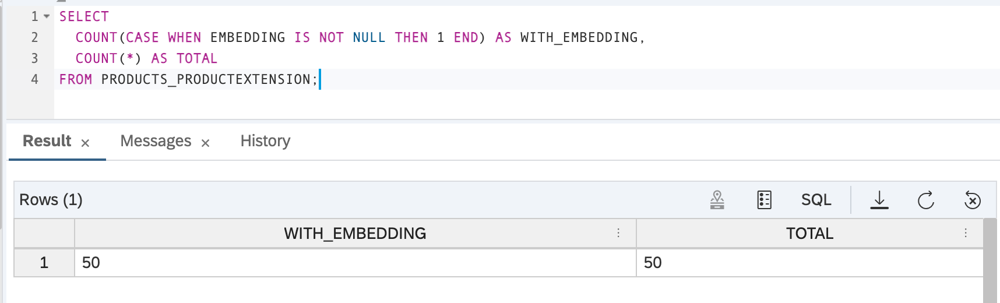

**Check the vector values:**

```sql
SELECT PRODUCT, SUBSTRING(TO_NVARCHAR(EMBEDDING), 1, 80) AS EMBEDDING_PREVIEW
FROM PRODUCTS_PRODUCTEXTENSION
WHERE EMBEDDING IS NOT NULL
LIMIT 3;
```

The `EMBEDDING_PREVIEW` column shows the start of the stored vector as a comma-separated string of numbers.

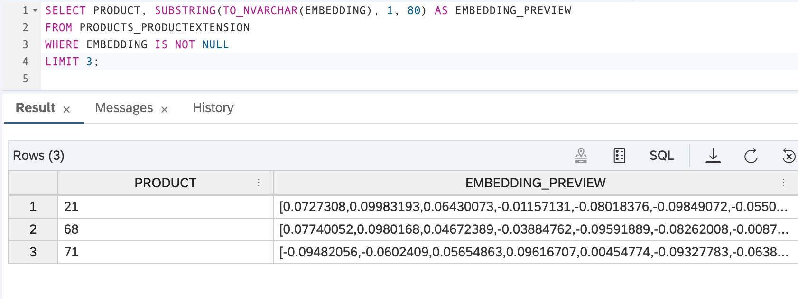

---

## Summary

You now have:
- Experience with the HANA Database Explorer for browsing and querying data
- All 50 service charges enriched with AI embeddings stored in the `REAL_VECTOR(1536)` column
- Data ready for hybrid search in Exercise 4

**Next**: Combine keyword search and semantic search into one powerful hybrid query.

Continue to [Exercise 4 – Hybrid Search: Full-Text + Semantic](../ex4/README.md)
