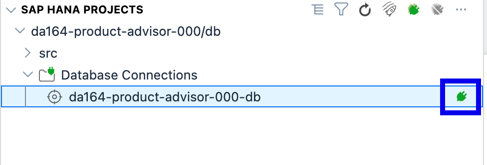
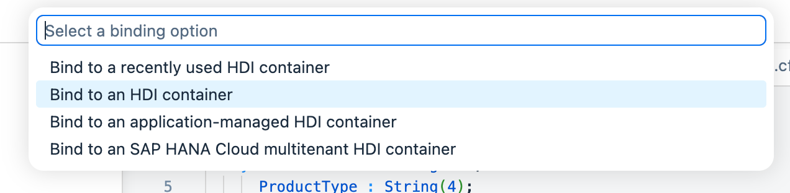
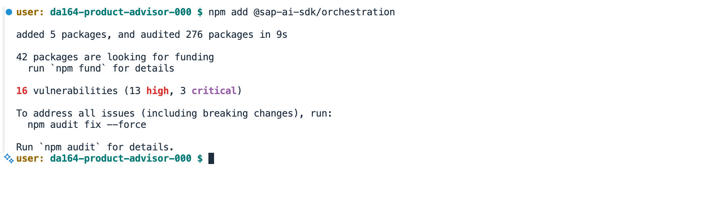
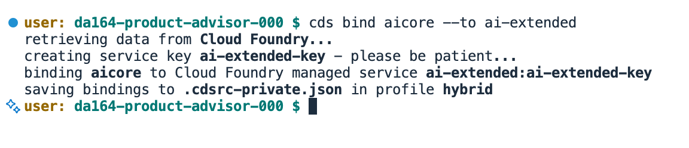

# Exercise 3 – Enrich Products with AI Embeddings

In this exercise you will open the **SAP HANA Database Explorer** — a browser-based SQL tool built into HANA Cloud — to look at the table you created in Exercise 2. Then you will run a script that generates AI embeddings for all service charge descriptions and stores them in the `Embedding` column.

> **What is an embedding?**
> An embedding is a list of numbers that captures the *meaning* of a piece of text. Two descriptions that mean something similar will have similar numbers — even if they use completely different words. HANA Cloud stores these natively in a `REAL_VECTOR` column so you can search by meaning in Exercise 4.

> **Story context:**
> Service charge descriptions in S/4HANA are written in shorthand for logistics experts, not customers. *"Demurrage/Detention Charges"* doesn't help a customer asking *"what do I pay if my container sits at the port longer than expected?"*. In this exercise you will generate AI embeddings that encode the *meaning* of every service charge description — so HANA can later find charges by what they cover, not just by the words used to name them. This is the step that makes Maya's problem solvable.

---

## What you will do

1. Open the HANA Database Explorer from BTP
2. Browse your product table and inspect its columns
3. Run a few SQL queries to explore the data
4. Run the embedding script to fill the `Embedding` column
5. Verify the embeddings are stored correctly

---

## Step 1 – Open HANA Database Explorer

> **Important**: Always open the Database Explorer from the **SAP HANA PROJECTS** panel in BAS — do not try to create the database connection from inside the Database Explorer itself.

1. In BAS, look at the bottom of the left sidebar. Find the **SAP HANA PROJECTS** panel. Expand your project's `db` entry. You will see **Database Connections** with nothing bound yet.



2. Hover over **Database Connections** and click the **+** icon. A prompt appears asking what to bind. Select **HDI Container**.



3. Choose your HDI container `da164-hdi-<your-number>` from the list. The container appears under **Database Connections**. Click the **cube icon** on the right side of the row to open the Database Explorer.


4. BAS asks whether to open an external website. Click **Open**.


5. A browser tab opens with the BTP login page. Click **Sign in with default identity provider**.


6. An application authorization page appears. Click **Authorize**.


7. The HANA Database Explorer loads.


---

## Step 2 – Find Your Product Table

1. In the left panel, expand **Tables**. You will see `PRODUCTS_PRODUCTEXTENSION` listed.

2. Click `PRODUCTS_PRODUCTEXTENSION` to open it. Then click **Open Data** to see the rows.

You should see the 50 product rows you synced in Exercise 2, with `EMBEDDING` empty for now.


---

## Step 3 – Inspect the Table Structure

1. Click on `PRODUCTS_PRODUCTEXTENSION` in the left panel. The column definitions open on the right.


Confirm you can see these columns:

| Column | Type |
|---|---|
| `PRODUCT` | NVARCHAR(40) |
| `DESCRIPTION` | NVARCHAR(500) |
| `EMBEDDING` | REAL_VECTOR(768) |

> The `REAL_VECTOR(768)` type is HANA Cloud's built-in vector column. It stores 768 numbers per row — one for each dimension of the AI embedding.

---

## Step 4 – Run Some SQL Queries

1. Right-click on your database connection in the left panel and choose **Open SQL Console**.


2. Count how many products you have:

```sql
SELECT COUNT(*) AS TOTAL FROM PRODUCTS_PRODUCTEXTENSION;
```

Click the **Run** button (green triangle). The result should show `50`.


3. Preview the descriptions:

```sql
SELECT PRODUCT, PRODUCTTYPE, LEFT(DESCRIPTION, 80) AS DESCRIPTION
FROM PRODUCTS_PRODUCTEXTENSION
ORDER BY PRODUCT
LIMIT 10;
```


---

## Step 5 – Set Up the AI Core Client

1. Install the SAP AI SDK. In the terminal:

```bash
npm add @sap-ai-sdk/orchestration
```



2. Add an `aicore` entry to the `"requires"` section in `package.json`:

```json
"requires": {
  "aicore": {
    "vcap": { "label": "aicore" }
  },
  ...
}
```

3. Create the file `srv/ai-core-client.js` with the following content:

```js
const { OrchestrationClient } = require('@sap-ai-sdk/orchestration')
const cds = require('@sap/cds')

const MODEL = 'gpt-4o-mini'

function ensureCredentials() {
  if (process.env.VCAP_SERVICES || process.env.AICORE_SERVICE_KEY) return
  const creds = cds.env.requires?.aicore?.credentials
  if (creds) process.env.AICORE_SERVICE_KEY = JSON.stringify(creds)
}

async function chatCompletion(messages) {
  ensureCredentials()
  const response = await new OrchestrationClient({
    promptTemplating: {
      model: { name: MODEL, params: { max_tokens: 500 } },
      prompt: { template: messages }
    }
  }).chatCompletion()
  return response.getContent()
}

module.exports = { chatCompletion }
```


4. Bind the shared AI Core service to your project. In the terminal:

```bash
cds bind aicore --to ai-extended
```



CAP creates a service key and stores the credentials locally — no credential files to manage and nothing to add to `.gitignore`.

> **How it works**: In hybrid mode `cds bind` stores credentials in `~/.cds-services.json`. The `ensureCredentials()` function in `ai-core-client.js` reads these and makes them available to the SDK. When deployed to Cloud Foundry, the `ai-extended` service is bound to the app directly and the SDK reads from `VCAP_SERVICES` automatically.

---

## Step 6 – Generate Embeddings

HANA Cloud has a built-in embedding model (`SAP_GXY.20250407`) that generates embeddings directly in SQL — no external service needed.

1. Switch back to the **HANA Database Explorer** SQL Console and run:

```sql
UPDATE PRODUCTS_PRODUCTEXTENSION
SET EMBEDDING = VECTOR_EMBEDDING(
  'Product: ' || PRODUCT || '. ' || DESCRIPTION,
  'DOCUMENT',
  'SAP_GXY.20250407'
)
WHERE EMBEDDING IS NULL;
```

Click **Run**. HANA generates a 768-dimensional embedding for each product description using its built-in AI model. All 50 rows should complete in a few seconds.

> **`DOCUMENT` vs `QUERY`**: Use `DOCUMENT` when storing embeddings (optimised for retrieval). Use `QUERY` when embedding a search string at query time — you will see this in Exercise 4.


---

## Step 7 – Verify in Database Explorer

Switch back to the **HANA Database Explorer** and run these queries in the SQL Console.

**Check how many embeddings were stored:**

```sql
SELECT
  COUNT(CASE WHEN EMBEDDING IS NOT NULL THEN 1 END) AS WITH_EMBEDDING,
  COUNT(*) AS TOTAL
FROM PRODUCTS_PRODUCTEXTENSION;
```

Both numbers should match.


**Check the vector values:**

```sql
SELECT PRODUCT, SUBSTRING(TO_NVARCHAR(EMBEDDING), 1, 80) AS EMBEDDING_PREVIEW
FROM PRODUCTS_PRODUCTEXTENSION
WHERE EMBEDDING IS NOT NULL
LIMIT 3;
```

The `EMBEDDING_PREVIEW` column shows the start of the stored vector as a comma-separated string of numbers.


---

## Summary

You now have:
- Experience with the HANA Database Explorer for browsing and querying data
- All 50 service charges enriched with AI embeddings stored in the `REAL_VECTOR(768)` column
- Data ready for hybrid search in Exercise 4

**Next**: Combine keyword search and semantic search into one powerful hybrid query.

Continue to [Exercise 4 – Hybrid Search: Full-Text + Semantic](../ex4/README.md)
