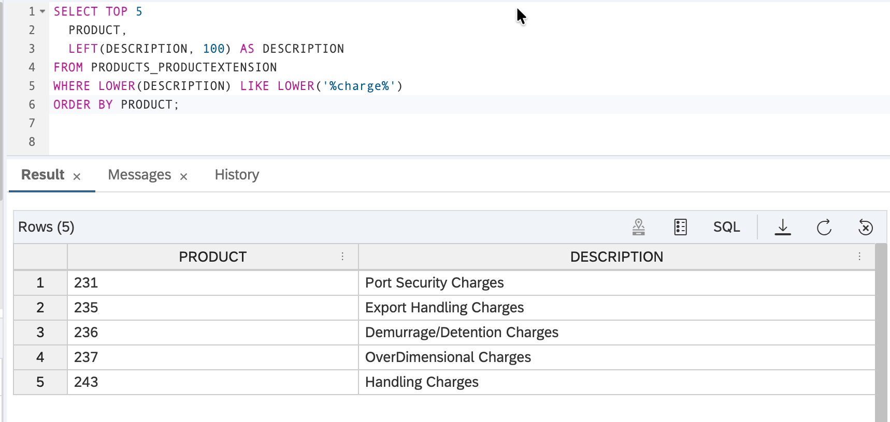
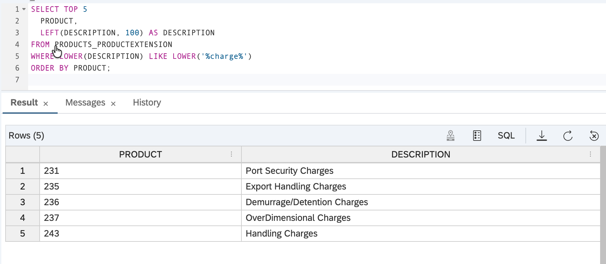
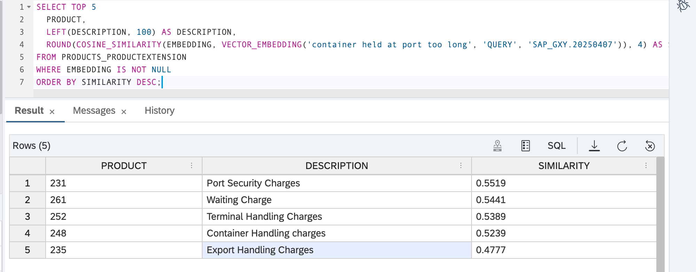
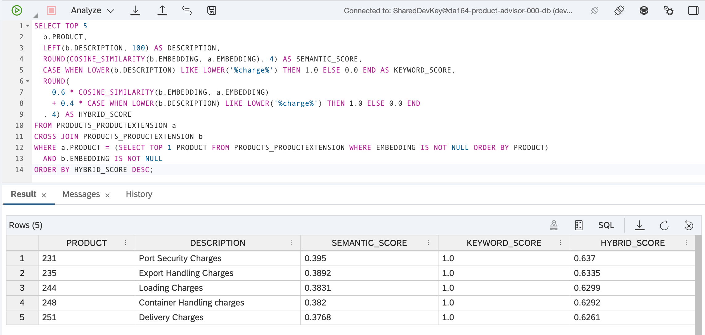
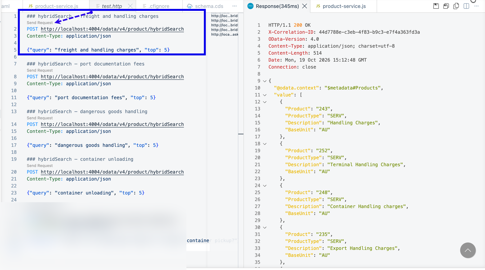
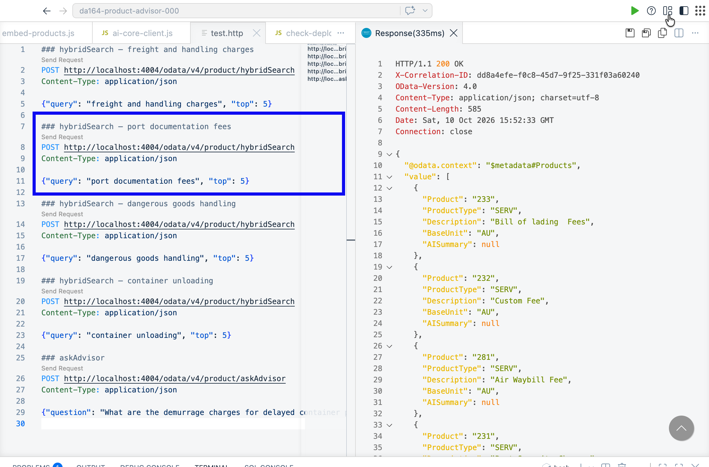
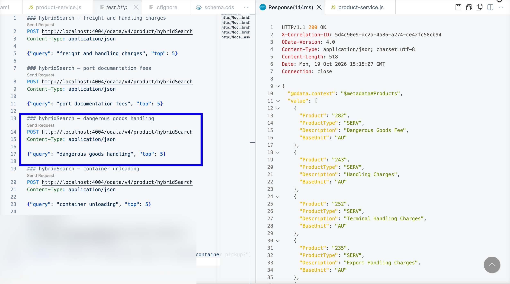
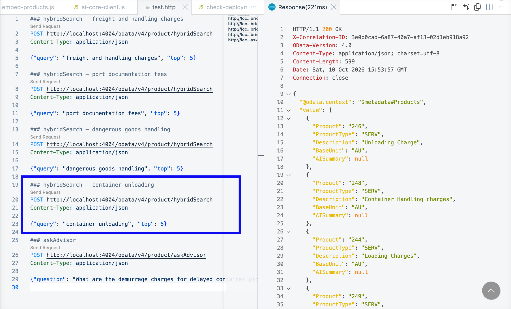

# Exercise 4 – Hybrid Search: Full-Text + Semantic

In this exercise you will build a search feature that combines two types of search available natively in HANA Cloud:

- **Keyword search** — finds service charges where the exact words appear in the description
- **Semantic search** — finds service charges that *cover* something similar to your query, even if the words don't match

Using both together gives better results than either one alone.

> **Story context:**
> Maya's customer asks: *"What charges apply when my container is held at port past the free period?"* A keyword search returns nothing — those exact words aren't in any charge description. A pure semantic search finds related charges but might miss a specific code the customer already knows. In this exercise you will build hybrid search that handles both cases at once — and for the first time, Maya can answer a customer inquiry in seconds instead of 30 minutes.

---

## Why combine them?

| Search type | Good for | Not good for |
|---|---|---|
| Keyword (`LIKE`) | Exact charge codes like "Demurrage/Detention" | Queries that use different wording |
| Semantic (`COSINE_SIMILARITY`) | Concepts and scenarios ("held at port too long") | Exact charge codes the caller already knows |
| **Hybrid (both)** | Everything above | — |

---

## What you will do

1. Try each search type separately in HANA Database Explorer
2. Write the combined hybrid query
3. Add it as a CAP action in your service
4. Test it and compare the results

---

## Step 1 – Try Keyword Search in HANA Database Explorer

1. Open the **HANA Database Explorer** (same as Exercise 3) and open the **SQL Console**.



2. Run this keyword search:

```sql
SELECT TOP 5
  PRODUCT,
  LEFT(DESCRIPTION, 100) AS DESCRIPTION
FROM PRODUCTS_PRODUCTEXTENSION
WHERE LOWER(DESCRIPTION) LIKE LOWER('%charge%')
ORDER BY PRODUCT;
```

Click the **Run** button (green triangle).



Try a few different keywords — `'%freight%'`, `'%fee%'`, `'%handling%'` — and see which products appear. Write down 2–3 results.

---

## Step 2 – Try Semantic Search

Semantic search finds products by *meaning*, not just matching words. `VECTOR_EMBEDDING` converts your query string into a vector at query time — HANA then measures how close that vector is to each stored product embedding.

Run:

```sql
SELECT TOP 5
  PRODUCT,
  LEFT(DESCRIPTION, 100) AS DESCRIPTION,
  ROUND(COSINE_SIMILARITY(EMBEDDING, VECTOR_EMBEDDING('container held at port too long', 'QUERY', 'SAP_GXY.20250407')), 4) AS SIMILARITY
FROM PRODUCTS_PRODUCTEXTENSION
WHERE EMBEDDING IS NOT NULL
ORDER BY SIMILARITY DESC;
```

None of the product descriptions contain the phrase "held at port too long" — yet the results show charges that are semantically relevant to that scenario.



---

## Step 3 – Write the Hybrid Query

The hybrid query runs both searches and combines the scores. 60% weight goes to semantic, 40% to keyword.

Run this in the SQL Console:

```sql
SELECT TOP 5
  PRODUCT,
  LEFT(DESCRIPTION, 100) AS DESCRIPTION,
  ROUND(COSINE_SIMILARITY(EMBEDDING, VECTOR_EMBEDDING('container held at port too long', 'QUERY', 'SAP_GXY.20250407')), 4) AS SEMANTIC_SCORE,
  CASE WHEN LOWER(DESCRIPTION) LIKE LOWER('%charge%') THEN 1.0 ELSE 0.0 END AS KEYWORD_SCORE,
  ROUND(
    0.6 * COSINE_SIMILARITY(EMBEDDING, VECTOR_EMBEDDING('container held at port too long', 'QUERY', 'SAP_GXY.20250407'))
    + 0.4 * CASE WHEN LOWER(DESCRIPTION) LIKE LOWER('%charge%') THEN 1.0 ELSE 0.0 END
  , 4) AS HYBRID_SCORE
FROM PRODUCTS_PRODUCTEXTENSION
WHERE EMBEDDING IS NOT NULL
ORDER BY HYBRID_SCORE DESC;
```



Notice how `HYBRID_SCORE` promotes products that score well in *either* dimension — products that match the keyword but are semantically distant, or products that are semantically close but don't use the exact word.

---

## Step 4 – Add the Handler in CAP

Now you will add this search as a proper API action so any client can use it with a plain-English query string.

1. Open [srv/product-service.js](../../srv/product-service.js).

2. Inside `init()`, after the line `const s4 = await cds.connect.to('API_PRODUCT_SRV')`, add:

```js
const db = await cds.connect.to('db')
```

3. After the closing `})` of the `syncProducts` handler, add the `hybridSearch` handler:

```js
this.on('hybridSearch', async (req) => {
  const { query, top = 5 } = req.data
  const likePattern = `%${query}%`

  const results = await db.run(
    `SELECT TOP ${top}
       PRODUCT, PRODUCTTYPE, DESCRIPTION, BASEUNIT,
       ROUND(
         0.6 * COSINE_SIMILARITY(EMBEDDING, VECTOR_EMBEDDING(?, 'QUERY', 'SAP_GXY.20250407'))
         + 0.4 * CASE WHEN LOWER(DESCRIPTION) LIKE LOWER(?) THEN 1.0 ELSE 0.0 END
       , 4) AS HYBRID_SCORE
     FROM PRODUCTS_PRODUCTEXTENSION
     WHERE EMBEDDING IS NOT NULL
     ORDER BY HYBRID_SCORE DESC`,
    [query, likePattern]
  )

  return results.map(r => ({
    Product:     r.PRODUCT,
    ProductType: r.PRODUCTTYPE,
    Description: r.DESCRIPTION,
    BaseUnit:    r.BASEUNIT
  }))
})
```

> **How the scoring works**: Each result gets a `HYBRID_SCORE` between 0 and 1. `VECTOR_EMBEDDING(?, 'QUERY', 'SAP_GXY.20250407')` converts your search string into a 768-dimensional vector using HANA's built-in AI model — no external service call needed. `COSINE_SIMILARITY` then measures meaning overlap against the stored product embeddings. The keyword part is 1.0 if the query words appear in the description, 0.0 if not. Combining them 60/40 means semantically close products rank even higher when they also match your words.

---

## Step 5 – Test the API

1. Check your terminal — if `cds watch --profile hybrid` is already running, press **Ctrl+C** to stop it. Then run:

```bash
cds watch --profile hybrid
```

2. Create a file called `test.http` at the **project root** with this content:

```http
### hybridSearch – freight and handling charges
POST http://localhost:4004/odata/v4/product/hybridSearch
Content-Type: application/json

{"query": "freight and handling charges", "top": 5}

### hybridSearch – port documentation fees
POST http://localhost:4004/odata/v4/product/hybridSearch
Content-Type: application/json

{"query": "port documentation fees", "top": 5}

### hybridSearch – dangerous goods handling
POST http://localhost:4004/odata/v4/product/hybridSearch
Content-Type: application/json

{"query": "dangerous goods handling", "top": 5}

### hybridSearch – container unloading
POST http://localhost:4004/odata/v4/product/hybridSearch
Content-Type: application/json

{"query": "container unloading", "top": 5}
```

3. Click **Send Request** above the first block (`freight and handling charges`). The response opens in a split pane on the right showing 5 ranked service charges.



4. Click **Send Request** for each of the remaining three queries and see how the ranked results change:







---

## Summary

You now have:
- Seen how keyword search and semantic search return different results for the same query
- A working hybrid search that combines both in one SQL query
- A `hybridSearch` CAP action that accepts plain-English queries and returns ranked service charges

**Next**: Use this search as the foundation for an AI advisor that answers product questions in full sentences.

Continue to [Exercise 5 – Build, Deploy, and Connect Your AI Product Advisor Agent](../ex5/README.md)
