# Exercise 6 – Expose Your CAP App as an MCP Server

In this exercise you will expose **your own CAP app** — the hybrid search and service charge advisor you built in Exercises 4 and 5 — as an MCP server using `@cap-js/mcp`. Any MCP-compatible AI assistant can then call your actions directly from a chat interface.

> **Story context:**
> The advisor works. Maya loves it. Now her development team wants to use it while they code — asking the service charge advisor questions from inside their AI coding assistant without switching tabs. In this exercise you will add one package and one annotation to your CAP app, and the entire advisor becomes available as a set of AI tools in OpenCode. No new server, no tool definitions, no glue code. This is what it looks like when your SAP application is AI-native by default.

---

## What you will do

1. Install the `@cap-js/mcp` plugin in your CAP project
2. Annotate your service with `@mcp` and write instructions for the AI
3. Deploy the updated app to Cloud Foundry
4. Configure OpenCode to connect to your MCP endpoint
5. Use OpenCode to search products and ask the advisor — from a chat window

---

## Step 1 – Install the Plugin

1. In the BAS terminal, navigate to your CAP project:

```bash
cd ~/projects/da164-product-advisor-<your-number>
```

2. Install the plugin:

```bash
npm add @cap-js/mcp
```

`@cap-js/mcp` is a CAP plugin — it activates automatically on startup with no extra wiring.

> **Note:** You may see npm audit warnings — ignore them.

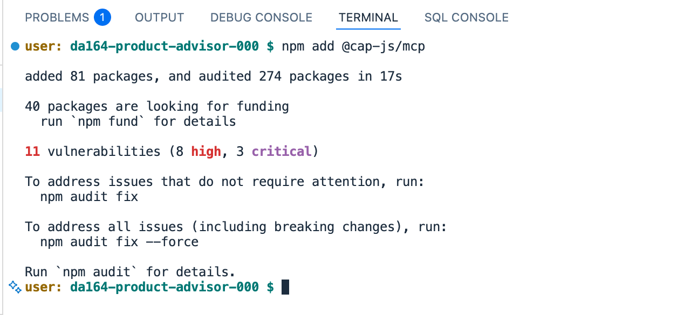

---

## Step 2 – Annotate the Service

1. Open [srv/product-service.cds](../../srv/product-service.cds).

2. Add `@mcp` on the line directly above `service ProductService`:

```cds
@mcp
@protocol: 'odata'
service ProductService {
  ...
}
```

3. Add this block **after** the closing `}` of the service to give the AI assistant instructions:

```cds
annotate ProductService with @mcp.instructions: 'You are a service charge advisor for a logistics company. The service charge data originates from SAP S/4HANA Cloud. Use "describe" first to learn what data and actions are available. Use "query" for structured lookups, e.g. SELECT * FROM Products WHERE ProductType = ''SERV''. Use "hybridSearch" to find service charges using natural language - it combines keyword and semantic search. Use "askAdvisor" for open-ended customer questions that need a full answer. Always include the charge code in your answers. Only recommend service charges that the tools return - never invent charges.';
```

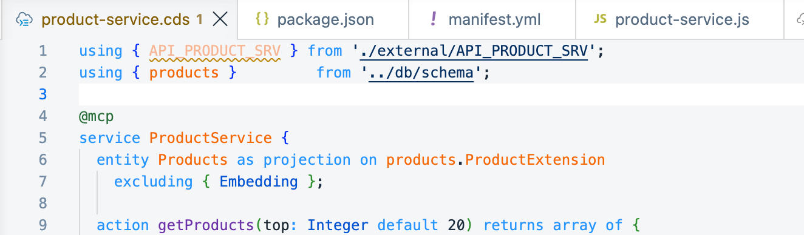

---

## Step 3 – Configure MCP Options

1. Open [package.json](../../package.json) and add the `"mcp"` block inside the `"cds"` section:

```json
"cds": {
  "mcp": {
    "per_action_tool": true,
    "format": "cql"
  },
  "requires": { ... }
}
```

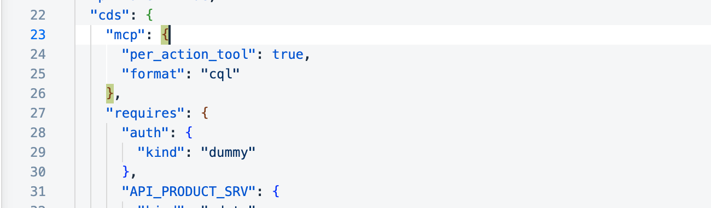

> With `per_action_tool: true` each of your actions becomes a separately named tool. OpenCode will see four tools:

| Tool | Source | What it does |
|---|---|---|
| `describe` | CAP built-in | Describes your entities and action signatures |
| `query` | CAP built-in | Runs a CQL SELECT against the Products table |
| `hybridSearch` | Your Ex4 action | Full-text + semantic search |
| `askAdvisor` | Your Ex5 action | RAG-based service charge advisor |

---

## Step 4 – Deploy the Updated App

1. Redeploy to Cloud Foundry so the changes take effect:

```bash
cf push
```

2. When the deploy finishes, note your app route:

```
routes: da164-product-<your-user>.cfapps.<landscape>.hana.ondemand.com
```

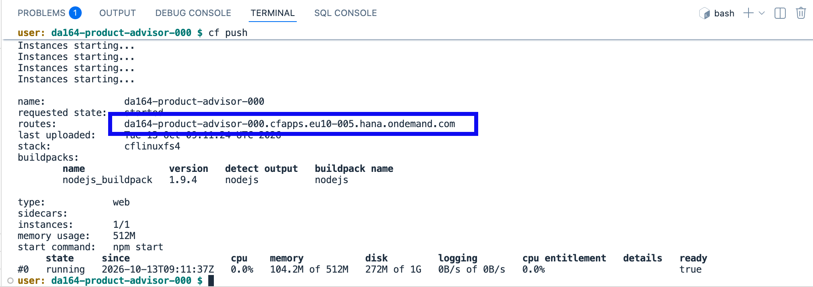

3. Verify the MCP endpoint is live:

```bash
curl -X POST https://<your-app-route>/mcp/product \
  -H "Content-Type: application/json" \
  -H "Accept: application/json, text/event-stream" \
  -d '{"jsonrpc":"2.0","method":"tools/list","id":1}'
```

You should get back a JSON response listing the four tools.

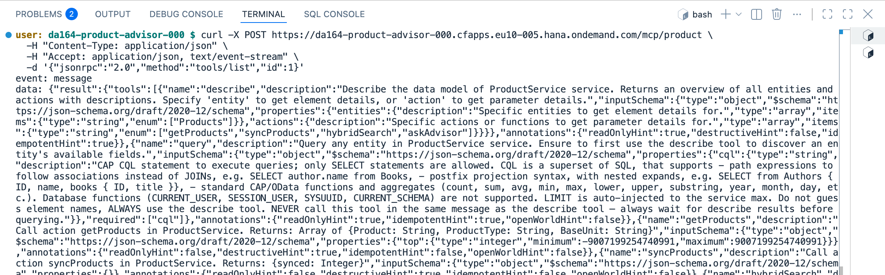

---

## Step 5 – Connect OpenCode

OpenCode reads MCP configuration from `opencode.json` in your project folder.

1. In BAS, right-click the project root and choose **New File**. Name it `opencode.json`.

2. Paste this content, replacing `<YOUR-APP-ROUTE>` with the URL from Step 4:

```json
{
  "$schema": "https://opencode.ai/config.json",
  "mcp": {
    "product-advisor": {
      "type": "remote",
      "url": "https://<YOUR-APP-ROUTE>/mcp/product",
      "enabled": true
    }
  }
}
```

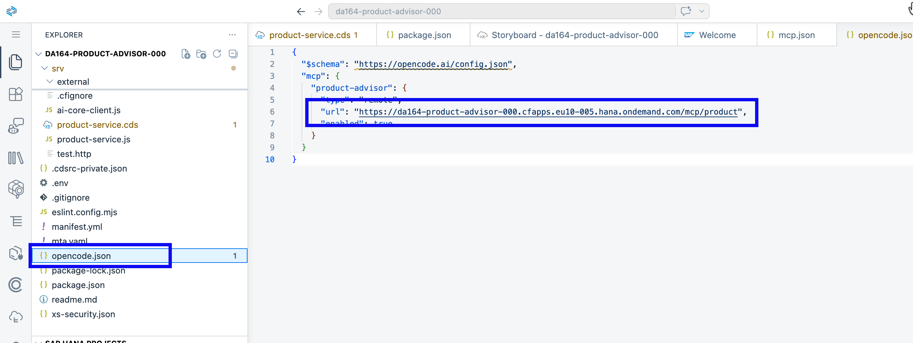

---

## Step 6 – Open OpenCode and Verify Tools

1. In the BAS terminal, start OpenCode:

```bash
npx opencode-ai@latest
```

When prompted "Ok to proceed? (y)" — type `y` and press Enter. OpenCode installs and launches as a fullscreen terminal interface. It reads `opencode.json` from your project root automatically.

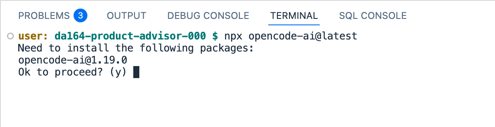

2. Type `/mcps` in the chat input and press Enter to open the MCPs panel. You should see **product-advisor connected ✓ Enabled**.

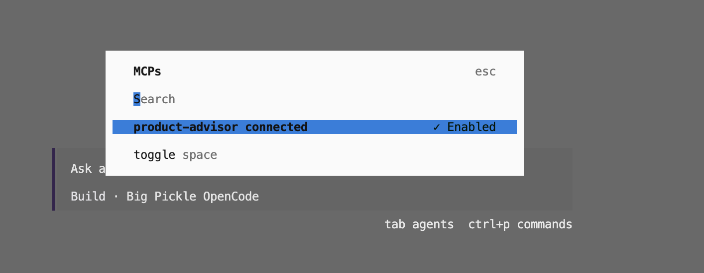

> The individual tools (`describe`, `query`, `hybridSearch`, `askAdvisor`) do not appear in a panel — OpenCode registers them automatically from the MCP server. In the next step you will use them directly from the chat.

If `product-advisor` does not appear, check that the URL in `opencode.json` matches your app route exactly and that the MCP server type is `"remote"`.

To exit OpenCode press **Ctrl+C** or type `/exit`.

---

## Step 7 – Try It Out

Type these messages in OpenCode one at a time:

---

**Explore the data first:**
```
What service charge data do you have? Describe the available information.
```
> OpenCode calls `describe` → learns your schema → explains what's available.

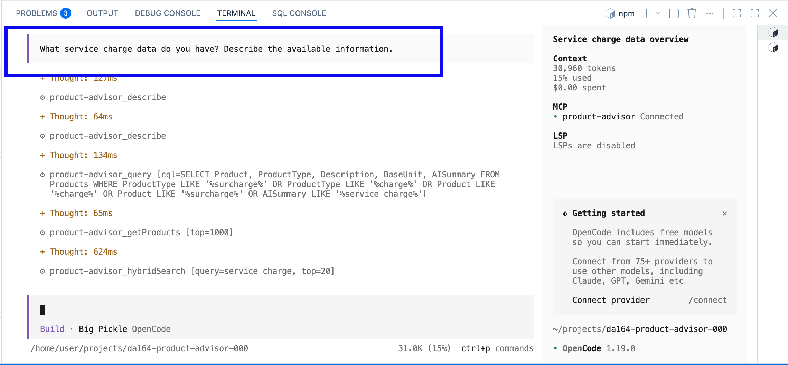

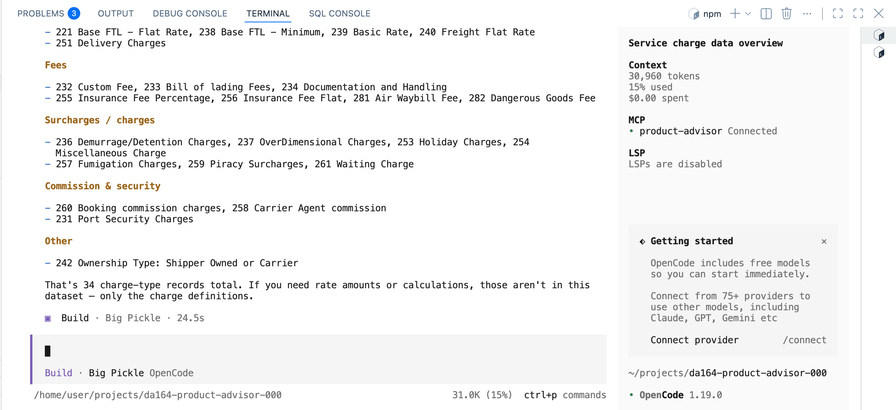

---

**Search by meaning:**
```
Find service charges applicable to hazardous goods shipments.
```
> OpenCode calls `hybridSearch` → HANA runs keyword + vector search → ranked results appear.

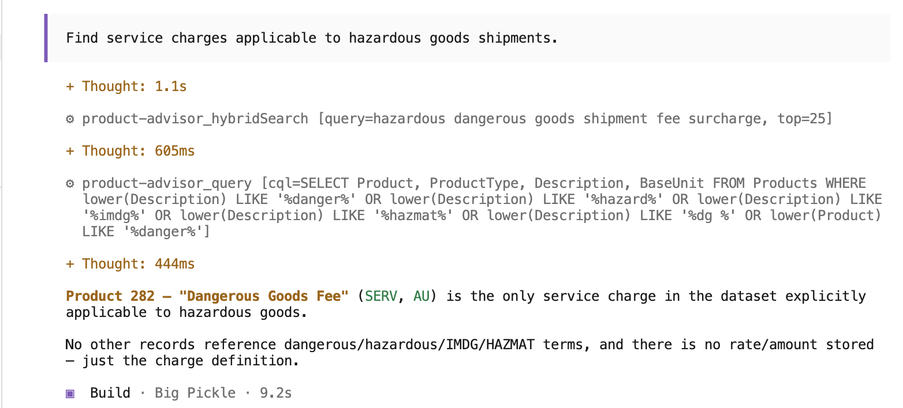

---

**Structured filter:**
```
List all surcharge types and their applicable conditions.
```
> OpenCode calls `query` with a CQL SELECT filtered by ProductType.

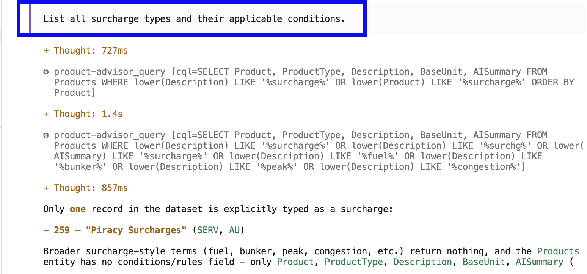

---

**Ask the advisor:**
```
A customer wants to know what charges apply for a delayed container pickup at the port. What would you recommend?
```
> OpenCode calls `askAdvisor` → HANA retrieves context → LLM generates a grounded answer.

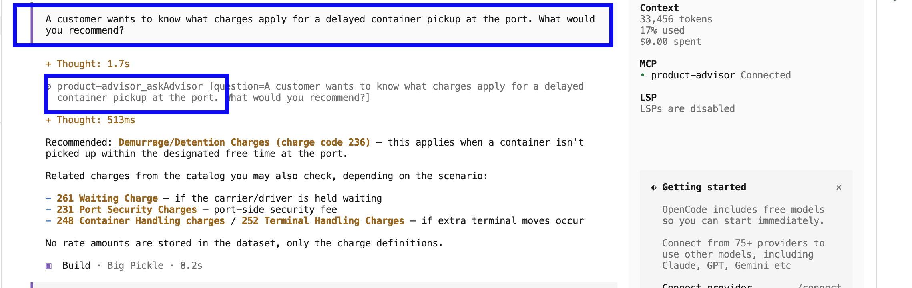

---

## Summary

You added **one package** and **one annotation** — and your CAP app became a fully working AI tool server. OpenCode discovered your tools automatically and used them to answer questions about real S/4HANA service charge data stored in HANA Cloud.

| Capability | Powered by |
|---|---|
| Schema discovery | CAP `describe` tool (auto-generated) |
| Structured filtering | CAP `query` tool + HANA SQL |
| Semantic + keyword search | Your `hybridSearch` action (Ex4) |
| Grounded Q&A | Your `askAdvisor` action + RAG (Ex5) |
| S/4HANA service charge data | BTP Destination → S/4HANA Cloud (Ex1) |

**Congratulations — you have now completed all exercises in DA164!**

---

*Back to [Exercise 4 – Hybrid Search: Full-Text + Semantic](../ex4/README.md) | [Session overview](../../README.md)*
